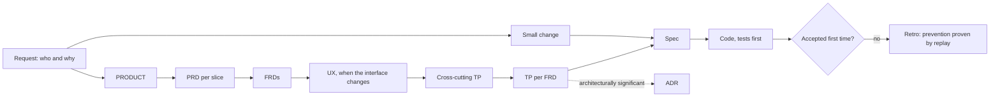

# Scriptorium

**Write the product before the code.** A checked document chain that AI coding agents write, build from, and are reviewed against.

[](https://github.com/antonygiomarxdev/scriptorium/releases) [](LICENSE)

Coding agents write code faster than anyone can say what the code should do. Spec-driven tools start at the spec; Scriptorium is the layer above it: why a change exists, what the product must do, which technical choices were made and why, and only then the spec. Each document rests on the one before, a script checks it, and only its owner approves it.

## Why

- **Agents rarely ask.** With a task underspecified, one model's resolve rate fell from 70.8% to 54.8%; given product context, compliance with product decisions rose from 46% to 95% ([research](docs/research/2026-11-19-practices-and-ai.md)).
- **Open review never converges.** An AI reviewer re-run on the same diff finds new things. Teams that lowered rework closed the loop: gates first, failures only against approved criteria, a cap on rounds ([research](docs/research/2026-11-20-lowering-rework.md)).
- **Tests written after the code copy its faults.** Tests grounded in the spec found 27 of 30 bugs; without it, 2 of 30 ([research](docs/research/2026-11-20-templates-tests-consistency.md)).

Scriptorium claims only what it measures: every run logs its rework, and the retro turns each recurring failure into a proven check.

## The chain



| Document | Says |
|---|---|
| **Request** | Who asked, what they said, the problem behind it |
| **Product** | Problem, users, numbered principles, use cases, scope, slices |
| **PRD** (per slice) | What the slice must do, as testable requirements. No technology |
| **FRD** (per feature) | Behavior, rules with positive and negative examples, decision and state tables, invariants, quality criteria. Acceptance criteria are generated from it |
| **UX** (per FRD, when needed) | Flows, screens, states, design-system components |
| **Cross-cutting TP** | Stack, storage, conventions, threat model. Written after the FRDs |
| **TP** (per FRD) | Options compared and the one chosen |
| **ADR** | An architecturally significant decision |
| **Spec** (per FRD) | Files, interfaces and ordered tests-first tasks. Decides nothing new |

Every document starts with a summary kept current, stays under a line cap, and cannot be approved with an open question. A small change takes a short path.

## Where documents live

```text
docs/
  PRODUCT.md  GLOSSARY.md  INVARIANTS.md  CROSS-CUTTING.md
  DECISIONS.md            decisions not yet absorbed into their document
  decisions/YYYY-MM.md    archive
  requests/REQ-n-name.md
  tp/TP.md                cross-cutting technical proposal
  adr/ADR-NNN-name.md
  retro/RETRO.md          open entries only; retro/YYYY-MM.md archive
  <slice>/
    PRD.md
    frd/FRD-NN-name.md
    ux/UX-NN-name.md
    tp/TP-NN-name.md
    specs/SPEC-NN-name.md
```

The checks read this layout: `docs/<slice>/` for each slice, never `src/`.

## Install

Claude Code (v1). The checks need [Bun](https://bun.sh).

```
/plugin install scriptorium --marketplace antonygiomarxdev/scriptorium
```

Turn on auto-update for the `scriptorium` marketplace under `/plugin` → Marketplaces to receive each release. Skills use the open SKILL.md format, so other agents can follow later.

| Skill | Does |
|---|---|
| `/scriptorium:scriptorium` | The overview: chain, layout, checks, short path, approval rules |
| `/scriptorium:init` | Starts the chain: PRODUCT, DECISIONS, GLOSSARY |
| `/scriptorium:adopt [path]` | Maps a project's existing documents into `docs/<slice>/`, offers to map undocumented code, reports the gaps, migrates after you approve the plan |
| `/scriptorium:prd <slice> <ID>` | Writes and checks a slice PRD |
| `/scriptorium:frd <slice> <ID>` | Writes and checks the slice FRDs |
| `/scriptorium:tp [cross \| <slice> <NN>]` | Writes and checks a TP and its ADRs |
| `/scriptorium:spec <slice> <NN>` | Writes and checks the spec for one FRD |
| `/scriptorium:status` | Shows every document, its status and what is next; fails on an approval above a draft or with an open question |

Skills for requests, decisions, glossary, UX, invariants, concerns, ADRs, review and retro are not written yet.

Or run a check directly: `bun scripts/check.ts prd docs/inbox/PRD.md INBOX`. Exit 0 passes; exit 1 prints every failure.

## Status

| Done | Next |
|---|---|
| Checks for PRD, FRD, TP, ADR, spec and status; one skill per step; adopt; versioned releases | Templates of the decided model; checks on `docs/`; requests, UX, questions, metrics and retro slices |

The decisions behind each part are in [docs/DECISIONS.md](docs/DECISIONS.md); the product itself in [docs/PRODUCT.md](docs/PRODUCT.md). Scriptorium is written with its own chain. It works alongside [puppeteering](https://github.com/antonygiomarxdev/puppeteering) for agent teams, and does not need it. First used on [Deputy](https://github.com/antonygiomarxdev/deputy).

## Develop

```bash
bun install
bun test
bun run typecheck
```

Every change a user would notice adds a changeset (`bunx changeset`). Release: on every push to `main`, the Version workflow keeps a "Version Packages" pull request open while changesets are pending (it bumps `package.json`, copies the version to `.claude-plugin/plugin.json` and writes `CHANGELOG.md`). Merging it tags `vX.Y.Z` and publishes the GitHub release. `bun run version` and `bun run release` still work by hand.

## License

MIT
