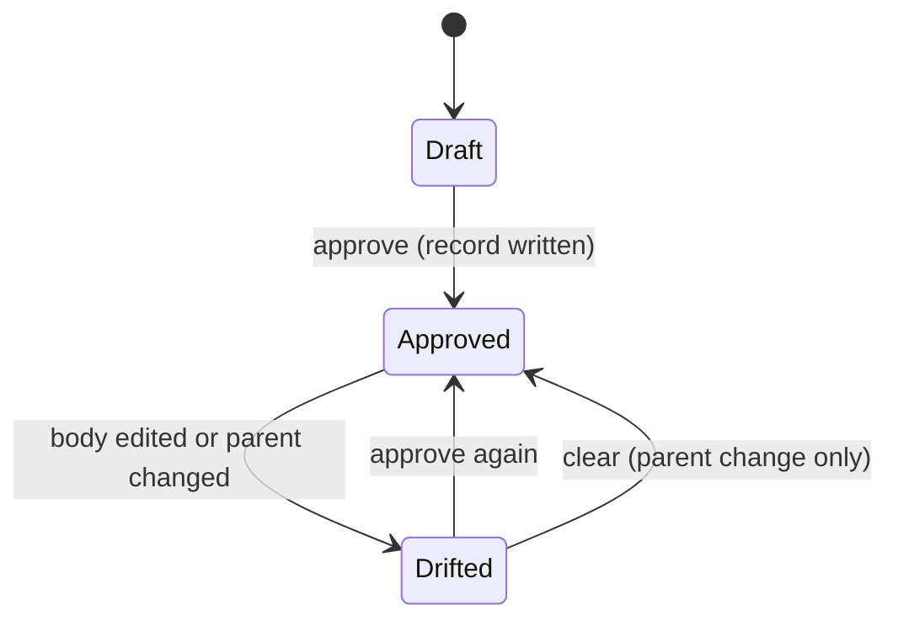

# FRD-01: Drift, traceability and history

Status: Approved (2026-11-20)
Approval: content DMw49CZMI-jd; rests on ../PRD.md weJ_tC_U7K43

## Summary

An owner who approves a document gets a record of what it said and what it rested on. From then on a check fails the document when its body is edited or its parent changes, until the owner approves again or clears the parent change. Tests name the examples they cover, and a scan fails dead names and approved examples nobody tests. The history of a document is read from git on request, never kept in the document. No document carries a version number.

Last change: 2026-11-20, a missing Approval line is a warning, not a failure (FR-CHAIN-01-3, EX-5, DT-2)

One feature of the [slice PRD](../PRD.md). No technology names. Every row has an id; tests, specs and review findings cite the ids.

## Why
No request is recorded. It answers D-28 and L-14 in [the decision inbox](../../DECISIONS.md), with the [research](../../research/2026-11-20-traceability-tools.md) behind them.

## Requirements covered
R-CHAIN-9, R-CHAIN-23, R-CHAIN-24, R-CHAIN-25.

## Behavior

| ID | Pattern | Requirement |
|---|---|---|
| FR-CHAIN-01-1 | always | The system shall compute a document's fingerprint from its normalized body: one line-ending style, no trailing spaces, and the Status, Approval and Last change lines left out. |
| FR-CHAIN-01-2 | WHEN | WHEN the owner approves a document, the system shall write an Approval line directly under its Status line, holding the document's fingerprint and the fingerprint of each document it rests on. |
| FR-CHAIN-01-3 | IF | IF an approved document has no Approval line THEN the check shall pass it with a warning that it was approved without an Approval line and must be approved again to record one. |
| FR-CHAIN-01-4 | IF | IF the fingerprint of an approved document's body differs from its record THEN the check shall fail it and say the body changed since approval. |
| FR-CHAIN-01-5 | IF | IF the fingerprint of a document it rests on differs from its record THEN the check shall fail it and say it is suspect because that parent changed. |
| FR-CHAIN-01-6 | WHEN | WHEN the owner clears a suspect document, the system shall rewrite the parent fingerprints in its record to the current ones and change nothing else. |
| FR-CHAIN-01-7 | IF | IF the owner clears a document that is a draft or whose own body changed THEN the system shall refuse and leave the file unchanged. |
| FR-CHAIN-01-8 | WHEN | WHEN status runs, the system shall list every drifted document with its cause (body edited or parent changed) and the parent concerned. |
| FR-CHAIN-01-9 | IF | IF a test carries a covers tag that names an example, state or invariant no FRD defines THEN the scan shall fail it as a dead tag. |
| FR-CHAIN-01-10 | IF | IF an example, state or invariant of an approved FRD has no covers tag and no waiver in that FRD THEN the scan shall fail it as uncovered. |
| FR-CHAIN-01-11 | IF | IF a coverage waiver in the FRD gives no reason THEN the scan shall fail it. |
| FR-CHAIN-01-14 | IF | IF a covers tag without a slice names an FRD number that more than one slice has THEN the scan shall fail it as ambiguous and name the slice-prefixed form. |
| FR-CHAIN-01-12 | WHEN | WHEN history is asked for a document, the system shall print one line per commit that touched it, newest first, from git, and shall write no file. |
| FR-CHAIN-01-13 | IF | IF a document carries a version number THEN the lint shall fail it. |

## Rules and examples

| Rule | Text | Covers |
|---|---|---|
| RULE-1 | The fingerprint changes with the words of the body and with nothing else: not with line endings, trailing spaces, or the Status, Approval and Last change lines. | FR-CHAIN-01-1 |
| RULE-2 | An approved document has an Approval line directly under its Status line, written when the owner approves; a document approved without one passes with a warning. | FR-CHAIN-01-2, FR-CHAIN-01-3 |
| RULE-3 | An approved document whose body fingerprint differs from its record fails. | FR-CHAIN-01-4 |
| RULE-4 | An approved document whose parent fingerprint differs from its record is suspect and fails. | FR-CHAIN-01-5, FR-CHAIN-01-8 |
| RULE-5 | Clearing rewrites only the parent fingerprints, and only for a suspect approved document whose own body is unchanged. | FR-CHAIN-01-6, FR-CHAIN-01-7 |
| RULE-6 | Every covers tag names a defined id, with a slice prefix unless one slice has that FRD number. Every example, state and invariant of an approved FRD has a tag or a waiver with a reason, written "uncovered: \<id\> \<reason\>" in that FRD's Coverage waivers list, so the owner approves it with the FRD. | FR-CHAIN-01-9, FR-CHAIN-01-10, FR-CHAIN-01-11, FR-CHAIN-01-14 |
| RULE-7 | History comes from git and is never stored in a document. | FR-CHAIN-01-12 |
| RULE-8 | No document carries a version number. | FR-CHAIN-01-13 |

| Example | Rule | Kind | Given | When | Then |
|---|---|---|---|---|---|
| EX-1 | RULE-1 | positive | Two files hold the same text, one with LF line endings and one with CRLF, and one line carries two trailing spaces | the fingerprint of each is computed | the two fingerprints are equal |
| EX-2 | RULE-1 | positive | A PRD has Status: Draft; a copy has Status: Approved (2026-11-21), an Approval line and a different Last change line | the fingerprint of each is computed | the two fingerprints are equal |
| EX-3 | RULE-1 | negative | A copy of a PRD has "shall" changed to "should" in one requirement | the fingerprint of each is computed | the two fingerprints differ |
| EX-4 | RULE-2 | positive | A PRD in draft rests on ../PRODUCT.md | the owner approves it on 2026-11-21 | line 3 reads "Approval: content \<12 characters\>; rests on ../PRODUCT.md \<12 characters\>", directly under "Status: Approved (2026-11-21)" |
| EX-5 | RULE-2 | negative | A PRD says "Status: Approved (2026-11-21)" and has no Approval line | the check runs | the check passes with a warning "PRD.md: approved without an Approval line; approve it again to record one" |
| EX-6 | RULE-3 | negative | An approved FRD has one word of RULE-1 changed after approval, and its Last change line is updated | the check runs | it fails with "FRD-01-x.md: body changed since approval" |
| EX-7 | RULE-3 | positive | An approved FRD has only its Last change line changed after approval | the check runs | it passes |
| EX-8 | RULE-4 | negative | A PRD is approved resting on ../PRODUCT.md, then a requirement of PRODUCT.md is edited | the check runs on the PRD and status runs | the check fails with "suspect: ../PRODUCT.md changed since approval" and status lists the PRD as drift, cause "parent changed", parent ../PRODUCT.md |
| EX-9 | RULE-4 | positive | A PRD is approved resting on ../PRODUCT.md, then only PRODUCT.md's Last change line is edited | the check runs on the PRD | it passes |
| EX-10 | RULE-5 | positive | A PRD is suspect because ../PRODUCT.md changed, and its own body is unchanged | the owner clears it | the Approval line holds the current fingerprint of ../PRODUCT.md, every other line is unchanged, and the check passes |
| EX-11 | RULE-5 | negative | An approved PRD has its own body edited | the owner clears it | clear is refused with "body changed since approval: approve it again" and the file is unchanged |
| EX-12 | RULE-5 | negative | A PRD has Status: Draft | the owner clears it | clear is refused with "not approved: nothing to clear" and the file is unchanged |
| EX-13 | RULE-6 | positive | Approved FRD-01 defines EX-1 and EX-2, and tests carry "covers: FRD-01/EX-1" and "covers: FRD-01/EX-2" | the scan runs | it passes |
| EX-14 | RULE-6 | negative | A test carries "covers: FRD-01/EX-9" and FRD-01 defines no EX-9 | the scan runs | it fails with "dead tag FRD-01/EX-9" and names the test file |
| EX-15 | RULE-6 | negative | Approved FRD-01 defines EX-3 and no test carries a tag for it | the scan runs | it fails with "uncovered: FRD-01/EX-3" |
| EX-16 | RULE-6 | boundary | Approved FRD-01 defines EX-3 and no test tags it, and its Coverage waivers list holds "uncovered: EX-3 needs a real clock" | the scan runs | it passes |
| EX-17 | RULE-6 | negative | Approved FRD-01's Coverage waivers list holds "uncovered: EX-3" with nothing after the id | the scan runs | it fails with "waiver without a reason: FRD-01/EX-3" |
| EX-22 | RULE-6 | negative | Slices chain and pickups both have an FRD-01, and a test carries "covers: FRD-01/EX-1" | the scan runs | it fails with "ambiguous tag FRD-01/EX-1: write chain/FRD-01/EX-1 or pickups/FRD-01/EX-1" |
| EX-23 | RULE-6 | positive | Slices chain and pickups both have an FRD-01, and a test carries "covers: chain/FRD-01/EX-1" | the scan runs | the tag counts as covering EX-1 of the chain FRD-01 |
| EX-18 | RULE-7 | positive | A PRD was committed on 2026-11-18 with subject "docs: draft" and on 2026-11-20 with subject "docs: approve" | history is asked for it | two lines print, 2026-11-20 first, each holding the date, the short commit id and the subject, and no file changes |
| EX-19 | RULE-7 | boundary | A PRD exists but was never committed | history is asked for it | it prints "no history: not committed yet" and no file changes |
| EX-20 | RULE-8 | negative | A PRD has the line "Version: 1.2" | the lint runs | it fails with "version number in a document" and names the line |
| EX-21 | RULE-8 | positive | A PRD says in its prose that a requirement is met "by the 0.3.0 release" | the lint runs | it passes: a release named in prose is not a document version |

### Coverage waivers
None.

## Decision table
Applies to approved documents only; a draft is never checked for drift. The first row that matches wins, top to bottom.

| ID | Approval line present | Own body matches record | Parents match record | Result |
|---|---|---|---|---|
| DT-1 | yes | yes | yes | Pass |
| DT-2 | no | any | any | Pass with a warning: approved without an Approval line; approve it again to record one |
| DT-3 | yes | no | any | Fail: body changed since approval; the owner approves again |
| DT-4 | yes | yes | no | Fail: suspect, parent changed; the owner clears or approves again |

## States
A document is a draft or approved. Drift is found by the check, not stored: an approved document that no longer matches its record is drifted until the owner acts.

| ID | Transition | Allowed |
|---|---|---|
| ST-1 | Draft to Approved | Yes, by the owner's approval, which writes the record |
| ST-2 | Drifted to Approved by clear, when the parent changed | Yes, and only the parent fingerprints change |
| ST-3 | Drifted to Approved by clear, when the body changed | No: the owner approves again |
| ST-4 | Draft to Approved by clear | No: nothing to clear |

## Invariants
n/a: the repository keeps no invariants register yet; RULE-1 to RULE-8 are covered by the examples.

## Quality criteria

| ID | Characteristic (ISO/IEC 25010) | Criterion |
|---|---|---|
| QC-1 | Functional suitability | All 23 examples pass in the test run: 23 of 23, and the scan reports 0 uncovered examples of this FRD. |
| QC-2 | Performance efficiency | The drift check of a generated chain of 200 documents finishes in under 2 s on the CI runner, measured in one test. |
| QC-3 | Compatibility | EX-1 passes on both CI systems (Windows and Linux): equal fingerprints for LF and CRLF copies. |
| QC-4 | Interaction capability | Every failure message names the document, the cause and the owner's next step, asserted in one test per row of the decision table. |
| QC-5 | Reliability | A refused clear leaves the file byte-identical, asserted in EX-11 and EX-12. |
| QC-6 | Security | n/a: the record detects change, it does not prove who approved; the owner's review of the commit does that (R-CHAIN-3). |
| QC-7 | Maintainability | The scan reports 0 dead tags and 0 uncovered examples for this FRD at approval. |
| QC-8 | Flexibility | n/a: the ignored lines and the fingerprint length are fixed, not settings. |
| QC-9 | Safety | n/a: a wrong result delays an approval and endangers nobody. |

## Cross-cutting
n/a: the repository keeps no cross-cutting register yet.

## Information
Reads: the body, status line and parent link of every document; the covers tags in test files, the coverage waivers in each FRD; the commit log of each document. Keeps: one Approval line per approved document. A fingerprint is the first 12 characters of the base64url form of the SHA-256 of the normalized body. The record format is "Approval: content \<h\>; rests on \<path\> \<h\>", one "rests on" part per parent, with the path relative to the document's folder.

## Open questions
None.

## Acceptance criteria
Generated from the examples, decision table and states; never edited by hand.

- **AC-1** (EX-1): Given Two files hold the same text, one with LF line endings and one with CRLF, and one line carries two trailing spaces, when the fingerprint of each is computed, then the two fingerprints are equal.
- **AC-2** (EX-2): Given A PRD has Status: Draft; a copy has Status: Approved (2026-11-21), an Approval line and a different Last change line, when the fingerprint of each is computed, then the two fingerprints are equal.
- **AC-3** (EX-3): Given A copy of a PRD has "shall" changed to "should" in one requirement, when the fingerprint of each is computed, then the two fingerprints differ.
- **AC-4** (EX-4): Given A PRD in draft rests on ../PRODUCT.md, when the owner approves it on 2026-11-21, then line 3 reads "Approval: content \<12 characters\>; rests on ../PRODUCT.md \<12 characters\>", directly under "Status: Approved (2026-11-21)".
- **AC-5** (EX-5): Given A PRD says "Status: Approved (2026-11-21)" and has no Approval line, when the check runs, then the check passes with a warning "PRD.md: approved without an Approval line; approve it again to record one".
- **AC-6** (EX-6): Given An approved FRD has one word of RULE-1 changed after approval, and its Last change line is updated, when the check runs, then it fails with "FRD-01-x.md: body changed since approval".
- **AC-7** (EX-7): Given An approved FRD has only its Last change line changed after approval, when the check runs, then it passes.
- **AC-8** (EX-8): Given A PRD is approved resting on ../PRODUCT.md, then a requirement of PRODUCT.md is edited, when the check runs on the PRD and status runs, then the check fails with "suspect: ../PRODUCT.md changed since approval" and status lists the PRD as drift, cause "parent changed", parent ../PRODUCT.md.
- **AC-9** (EX-9): Given A PRD is approved resting on ../PRODUCT.md, then only PRODUCT.md's Last change line is edited, when the check runs on the PRD, then it passes.
- **AC-10** (EX-10): Given A PRD is suspect because ../PRODUCT.md changed, and its own body is unchanged, when the owner clears it, then the Approval line holds the current fingerprint of ../PRODUCT.md, every other line is unchanged, and the check passes.
- **AC-11** (EX-11): Given An approved PRD has its own body edited, when the owner clears it, then clear is refused with "body changed since approval: approve it again" and the file is unchanged.
- **AC-12** (EX-12): Given A PRD has Status: Draft, when the owner clears it, then clear is refused with "not approved: nothing to clear" and the file is unchanged.
- **AC-13** (EX-13): Given Approved FRD-01 defines EX-1 and EX-2, and tests carry "covers: FRD-01/EX-1" and "covers: FRD-01/EX-2", when the scan runs, then it passes.
- **AC-14** (EX-14): Given A test carries "covers: FRD-01/EX-9" and FRD-01 defines no EX-9, when the scan runs, then it fails with "dead tag FRD-01/EX-9" and names the test file.
- **AC-15** (EX-15): Given Approved FRD-01 defines EX-3 and no test carries a tag for it, when the scan runs, then it fails with "uncovered: FRD-01/EX-3".
- **AC-16** (EX-16): Given Approved FRD-01 defines EX-3 and no test tags it, and its Coverage waivers list holds "uncovered: EX-3 needs a real clock", when the scan runs, then it passes.
- **AC-17** (EX-17): Given Approved FRD-01's Coverage waivers list holds "uncovered: EX-3" with nothing after the id, when the scan runs, then it fails with "waiver without a reason: FRD-01/EX-3".
- **AC-18** (EX-18): Given A PRD was committed on 2026-11-18 with subject "docs: draft" and on 2026-11-20 with subject "docs: approve", when history is asked for it, then two lines print, 2026-11-20 first, each holding the date, the short commit id and the subject, and no file changes.
- **AC-19** (EX-19): Given A PRD exists but was never committed, when history is asked for it, then it prints "no history: not committed yet" and no file changes.
- **AC-20** (EX-20): Given A PRD has the line "Version: 1.2", when the lint runs, then it fails with "version number in a document" and names the line.
- **AC-21** (EX-21): Given A PRD says in its prose that a requirement is met "by the 0.3.0 release", when the lint runs, then it passes: a release named in prose is not a document version.
- **AC-22** (EX-22): Given Slices chain and pickups both have an FRD-01, and a test carries "covers: FRD-01/EX-1", when the scan runs, then it fails with "ambiguous tag FRD-01/EX-1: write chain/FRD-01/EX-1 or pickups/FRD-01/EX-1".
- **AC-23** (EX-23): Given Slices chain and pickups both have an FRD-01, and a test carries "covers: chain/FRD-01/EX-1", when the scan runs, then the tag counts as covering EX-1 of the chain FRD-01.
- **AC-24** (DT-1): Given an approved document with an Approval line, whose body matches and whose parents matches, when the check runs, then it passes.
- **AC-25** (DT-2): Given an approved document without an Approval line, when the check runs, then it passes with a warning: approved without an Approval line; approve it again to record one.
- **AC-26** (DT-3): Given an approved document with an Approval line, whose body differs and whose parents are any, when the check runs, then it fails: body changed since approval; the owner approves again.
- **AC-27** (DT-4): Given an approved document with an Approval line, whose body matches and whose parents differs, when the check runs, then it fails: suspect, parent changed; the owner clears or approves again.
- **AC-28** (ST-1): Given the transition "Draft to Approved", then it is allowed, by the owner's approval, which writes the record.
- **AC-29** (ST-2): Given the transition "Drifted to Approved by clear, when the parent changed", then it is allowed, and only the parent fingerprints change.
- **AC-30** (ST-3): Given the transition "Drifted to Approved by clear, when the body changed", then it is refused: the owner approves again.
- **AC-31** (ST-4): Given the transition "Draft to Approved by clear", then it is refused: nothing to clear.
