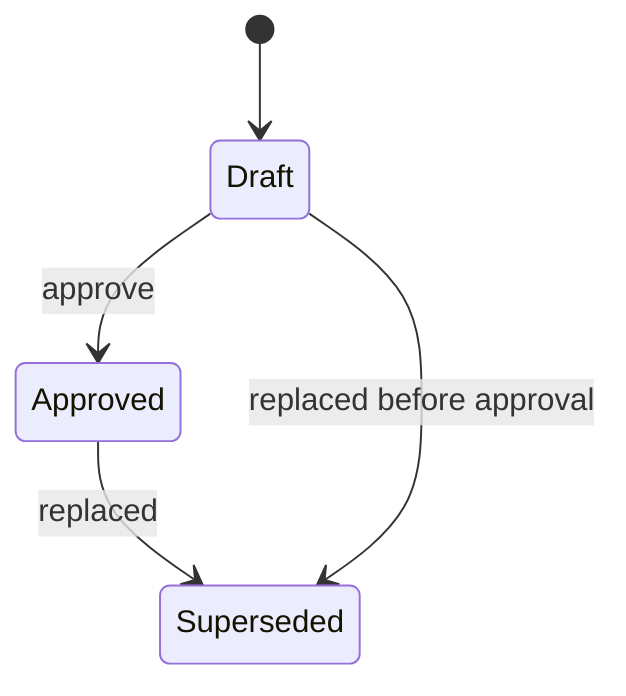

# FRD-02: Small specs, superseded documents and required changesets

Status: Approved (2026-11-20)
Approval: content P51qy6LO9pYx; rests on ../PRD.md soSaFDiaVe3Y

## Summary

A spec is one agent run: it names its parent, quotes the rows it builds verbatim, touches at most three files and has one done command, so a small model needs nothing else. Work that is not product rests on a TP, an ADR, a registry or an accepted request. A replaced document says what replaced it and the checks stop demanding from it. Where Changesets is used, a commit that changes code without a changeset fails.

Last change: 2026-11-20, paths and done commands behave the same on Windows and Linux, with one path helper and no branch on the system (RULE-7, EX-21 to EX-25)

One feature of the [slice PRD](../PRD.md). No technology names. Every row has an id; tests, specs and review findings cite the ids.

## Why
[REQ-1](../../requests/REQ-1-small-specs.md) and [REQ-2](../../requests/REQ-2-document-states.md), with the mechanism in L-15 of [the decision inbox](../../DECISIONS.md).

## Requirements covered
R-CHAIN-26, R-CHAIN-27, R-CHAIN-28, R-CHAIN-29.

## Behavior

| ID | Pattern | Requirement |
|---|---|---|
| FR-CHAIN-02-1 | IF | IF a spec has no Rests on line, or it names a file that does not exist or is not an FRD, TP, ADR, request or registry, THEN the check shall fail it. |
| FR-CHAIN-02-2 | IF | IF a quoted row of a spec is not found verbatim in the document it is quoted from THEN the check shall fail it and name the row. |
| FR-CHAIN-02-3 | IF | IF the ids under Tests first differ from the ids of the quoted rows THEN the check shall fail the spec and name the ids that differ. |
| FR-CHAIN-02-4 | IF | IF a spec has more than 80 lines, more than 3 rows in Files, or other than one command in Done when, THEN the check shall fail it. |
| FR-CHAIN-02-5 | WHEN | WHEN excerpt is asked for ids of a document, the system shall print the row lines whose first cell is each id, in the order asked. |
| FR-CHAIN-02-6 | WHEN | WHEN done is asked for an approved spec, the system shall run its Done when command and exit with its code; for a spec not approved it shall fail without running it. |
| FR-CHAIN-02-7 | IF | IF a document says it is superseded by a path that does not exist THEN status shall fail it. |
| FR-CHAIN-02-8 | IF | IF an approved document rests on a superseded one THEN status shall fail it. |
| FR-CHAIN-02-9 | always | The drift check and the coverage scan shall skip superseded documents. |
| FR-CHAIN-02-11 | always | Every path the checks print or write shall use forward slashes, every path read from a document shall resolve the same with either slash, and a done command shall run with the same shell rules on every system; no check branches on the operating system. |
| FR-CHAIN-02-10 | IF | IF a project has a changesets configuration and a commit stages a file outside the documents, the tests and the changesets folder without staging a new changeset THEN the pre-commit check shall fail it. |

## Rules and examples

| Rule | Text | Covers |
|---|---|---|
| RULE-1 | A spec names one existing parent of an allowed kind; registries count as approved. | FR-CHAIN-02-1 |
| RULE-2 | A spec's rows are quoted, never retold, and its tests are exactly those rows. | FR-CHAIN-02-2, FR-CHAIN-02-3, FR-CHAIN-02-5 |
| RULE-3 | A spec fits one agent run: 80 lines, 3 files, one done command. | FR-CHAIN-02-4 |
| RULE-4 | Done is computed by running the command of an approved spec, never written. | FR-CHAIN-02-6 |
| RULE-5 | A superseded document points to an existing replacement, nothing approved rests on it, and drift and coverage skip it. | FR-CHAIN-02-7, FR-CHAIN-02-8, FR-CHAIN-02-9 |
| RULE-6 | A code change carries a changeset where the project uses Changesets. | FR-CHAIN-02-10 |
| RULE-7 | A check gives the same output and the same result on Windows and Linux. | FR-CHAIN-02-11 |

| Example | Rule | Kind | Given | When | Then |
|---|---|---|---|---|---|
| EX-1 | RULE-1 | positive | A spec says "Rests on: ../../CHECKS.md" and that file exists | the check runs | the parent passes as approved |
| EX-2 | RULE-1 | negative | A spec has no Rests on line | the check runs | it fails with "no Rests on line" |
| EX-3 | RULE-1 | negative | A spec says "Rests on: ../tp/TP-09-x.md" and no such file exists | the check runs | it fails and names ../tp/TP-09-x.md |
| EX-4 | RULE-2 | positive | A spec quotes the EX-4 row of its FRD exactly | the check runs | the quote passes |
| EX-5 | RULE-2 | negative | A spec quotes the EX-4 row with "5 places" changed to "6 places" | the check runs | it fails with "quoted row not found" and names the row |
| EX-6 | RULE-2 | negative | Rows hold EX-4 and EX-5 and Tests first names EX-4 only | the check runs | it fails and names EX-5 |
| EX-7 | RULE-2 | positive | An FRD defines EX-4 and EX-5 | excerpt is asked for EX-5 and EX-4 | the EX-5 row prints, then the EX-4 row, byte for byte |
| EX-8 | RULE-2 | negative | An FRD defines no EX-9 | excerpt is asked for EX-9 | it fails and names EX-9 |
| EX-9 | RULE-3 | positive | A spec has 80 lines and 3 rows in Files | the check runs | it passes |
| EX-10 | RULE-3 | negative | A spec has 4 rows in Files | the check runs | it fails with "4 files, over 3" |
| EX-11 | RULE-3 | negative | A spec's Done when holds two commands | the check runs | it fails with "Done when needs exactly one command" |
| EX-12 | RULE-4 | positive | An approved spec's Done when is a command that exits 0 | done runs | it exits 0 |
| EX-13 | RULE-4 | negative | A spec is a draft | done runs | it fails with "not approved" and the command does not run |
| EX-14 | RULE-5 | negative | A TP says "Status: Superseded by TP-04-new.md (2026-11-20)" and no TP-04-new.md exists | status runs | it fails and names TP-04-new.md |
| EX-15 | RULE-5 | negative | An approved spec rests on a superseded TP | status runs | it fails and names the superseded TP |
| EX-16 | RULE-5 | positive | An FRD is superseded and its examples have no tests | the coverage scan runs | it passes |
| EX-17 | RULE-6 | negative | The project has a changesets configuration and a commit stages scripts/check.ts only | pre-commit runs | it fails and says to add a changeset |
| EX-18 | RULE-6 | positive | The same commit also stages a new changeset file | pre-commit runs | it passes |
| EX-19 | RULE-6 | boundary | A commit stages only documents and tests | pre-commit runs | it passes without a changeset |
| EX-20 | RULE-6 | boundary | The project has no changesets configuration | pre-commit runs on a code change | the rule does not apply |
| EX-21 | RULE-7 | negative | On Windows, approved FRD-02 in slice chain has an example no test tags | the coverage scan runs | the failure names chain/frd/FRD-02-small-specs-states.md with forward slashes and no backslash |
| EX-22 | RULE-7 | positive | On Windows, an approved spec's Done when is "bun test test/*.test.ts" | done runs | the glob expands as it does on Linux and the command exits 0 |
| EX-23 | RULE-7 | negative | On Windows, an approved spec rests on a superseded TP | status runs | the failure names both documents with forward slashes |
| EX-24 | RULE-7 | positive | A spec says "Rests on: ..\tp\TP-01-x.md" and that file exists | the check runs on Windows and on Linux | the parent resolves on both |
| EX-25 | RULE-7 | negative | A script tests the operating system, or turns backslashes into slashes outside the one path helper | the tests run | they fail and name the script and line |

### Coverage waivers
None.

## Decision table
Which documents a superseded document affects. The first row that matches wins.

| ID | Replacement exists | An approved document rests on it | Result |
|---|---|---|---|
| DT-1 | no | any | Fail: the replacement does not exist |
| DT-2 | yes | yes | Fail: the approved document must rest on the replacement |
| DT-3 | yes | no | Pass; drift and coverage skip it |

## States

| ID | Transition | Allowed |
|---|---|---|
| ST-1 | Approved to Superseded | Yes, naming the replacement |
| ST-2 | Superseded to Approved | No: write a new document |

## Invariants
n/a: the repository keeps no invariants register yet; RULE-1 to RULE-6 are covered by the examples.

## Quality criteria

| ID | Characteristic (ISO/IEC 25010) | Criterion |
|---|---|---|
| QC-1 | Functional suitability | All 25 examples pass, and the scan reports 0 uncovered ids of this FRD. |
| QC-2 | Performance efficiency | n/a: the checks read a few files per spec; FRD-01 QC-2 bounds the full run. |
| QC-3 | Compatibility | The quote check passes on both CI systems for a spec and an FRD with CRLF line endings. |
| QC-4 | Interaction capability | Every failure names the spec or document, the row or id, and the fix, asserted in the negative examples. |
| QC-5 | Reliability | done never runs the command of a draft spec, asserted in EX-13. |
| QC-6 | Security | done runs a command written in an approved spec, the same trust as a test script the owner approved; no hook runs it. |
| QC-7 | Maintainability | The scan reports 0 dead tags and 0 uncovered ids for this FRD at approval. |
| QC-8 | Flexibility | n/a: the caps are fixed; lowering them per project is R-CHAIN-6. |
| QC-9 | Safety | n/a: a wrong result delays a change and endangers nobody. |

## Cross-cutting
n/a: the repository keeps no cross-cutting register yet.

## Information
Reads: each spec's Rests on and Quoted from lines, its Rows, Files, Tests first and Done when sections; each document's status line; the staged file list and the changesets folder. Keeps nothing new.

## Open questions
None.

## Acceptance criteria
Generated from the examples, decision table and states; never edited by hand.

- **AC-1** (EX-1): Given A spec says "Rests on: ../../CHECKS.md" and that file exists, when the check runs, then the parent passes as approved.
- **AC-2** (EX-2): Given A spec has no Rests on line, when the check runs, then it fails with "no Rests on line".
- **AC-3** (EX-3): Given A spec says "Rests on: ../tp/TP-09-x.md" and no such file exists, when the check runs, then it fails and names ../tp/TP-09-x.md.
- **AC-4** (EX-4): Given A spec quotes the EX-4 row of its FRD exactly, when the check runs, then the quote passes.
- **AC-5** (EX-5): Given A spec quotes the EX-4 row with "5 places" changed to "6 places", when the check runs, then it fails with "quoted row not found" and names the row.
- **AC-6** (EX-6): Given Rows hold EX-4 and EX-5 and Tests first names EX-4 only, when the check runs, then it fails and names EX-5.
- **AC-7** (EX-7): Given An FRD defines EX-4 and EX-5, when excerpt is asked for EX-5 and EX-4, then the EX-5 row prints, then the EX-4 row, byte for byte.
- **AC-8** (EX-8): Given An FRD defines no EX-9, when excerpt is asked for EX-9, then it fails and names EX-9.
- **AC-9** (EX-9): Given A spec has 80 lines and 3 rows in Files, when the check runs, then it passes.
- **AC-10** (EX-10): Given A spec has 4 rows in Files, when the check runs, then it fails with "4 files, over 3".
- **AC-11** (EX-11): Given A spec's Done when holds two commands, when the check runs, then it fails with "Done when needs exactly one command".
- **AC-12** (EX-12): Given An approved spec's Done when is a command that exits 0, when done runs, then it exits 0.
- **AC-13** (EX-13): Given A spec is a draft, when done runs, then it fails with "not approved" and the command does not run.
- **AC-14** (EX-14): Given A TP says "Status: Superseded by TP-04-new.md (2026-11-20)" and no TP-04-new.md exists, when status runs, then it fails and names TP-04-new.md.
- **AC-15** (EX-15): Given An approved spec rests on a superseded TP, when status runs, then it fails and names the superseded TP.
- **AC-16** (EX-16): Given An FRD is superseded and its examples have no tests, when the coverage scan runs, then it passes.
- **AC-17** (EX-17): Given The project has a changesets configuration and a commit stages scripts/check.ts only, when pre-commit runs, then it fails and says to add a changeset.
- **AC-18** (EX-18): Given The same commit also stages a new changeset file, when pre-commit runs, then it passes.
- **AC-19** (EX-19): Given A commit stages only documents and tests, when pre-commit runs, then it passes without a changeset.
- **AC-20** (EX-20): Given The project has no changesets configuration, when pre-commit runs on a code change, then the rule does not apply.
- **AC-21** (EX-21): Given On Windows, approved FRD-02 in slice chain has an example no test tags, when the coverage scan runs, then the failure names chain/frd/FRD-02-small-specs-states.md with forward slashes and no backslash.
- **AC-22** (EX-22): Given On Windows, an approved spec's Done when is "bun test test/*.test.ts", when done runs, then the glob expands as it does on Linux and the command exits 0.
- **AC-23** (EX-23): Given On Windows, an approved spec rests on a superseded TP, when status runs, then the failure names both documents with forward slashes.
- **AC-24** (EX-24): Given A spec says "Rests on: ..\tp\TP-01-x.md" and that file exists, when the check runs on Windows and on Linux, then the parent resolves on both.
- **AC-25** (EX-25): Given A script tests the operating system, or turns backslashes into slashes outside the one path helper, when the tests run, then they fail and name the script and line.
- **AC-26** (DT-1): Given a superseded document whose replacement exists: no, and an approved document rests on it: any, when status runs, then fail: the replacement does not exist.
- **AC-27** (DT-2): Given a superseded document whose replacement exists: yes, and an approved document rests on it: yes, when status runs, then fail: the approved document must rest on the replacement.
- **AC-28** (DT-3): Given a superseded document whose replacement exists: yes, and an approved document rests on it: no, when status runs, then pass; drift and coverage skip it.
- **AC-29** (ST-1): Given the transition "Approved to Superseded", then it is allowed, naming the replacement.
- **AC-30** (ST-2): Given the transition "Superseded to Approved", then it is refused: write a new document.
