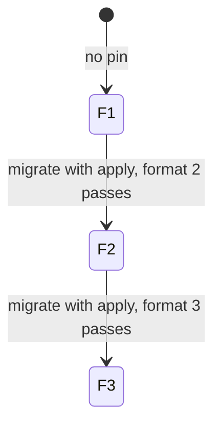

# FRD-03: Pinned formats, migrate and the command-line tool

Status: Approved (2026-11-20)
Approval: content qE3unsi9mr_h; rests on ../PRD.md ASR_OGQqlGDj

## Summary

Each project pins the format of its rules in its own `.scriptorium/` folder; with no pin it keeps the rules of 0.3.0. A rule from a newer format only warns until the project migrates, and one command migrates: a dry run first, mechanical rewrites only, the pin moved only when the next format passes. The checks also run as a `scriptorium` command any agent or CI can pin, and the git hook installs from the committed folder.

Last change: 2026-11-20, EX-19 to EX-26 from the review: no format 1 leak, dead tag, migrate lists all, CRLF, subfolder commit, CLI root, no fetched package, no pin downgrade

One feature of the [slice PRD](../PRD.md). No technology names. Every row has an id; tests, specs and review findings cite the ids.

## Why
[REQ-5](../../requests/REQ-5-safe-updates.md); owner decisions in D-31 and the mechanism in L-16 of [the decision inbox](../../DECISIONS.md), with the [research](../../research/2026-11-20-rule-evolution.md) behind them.

## Requirements covered
R-CHAIN-30, R-CHAIN-31, R-CHAIN-32, R-CHAIN-33, R-CHAIN-34.

## Behavior

| ID | Pattern | Requirement |
|---|---|---|
| FR-CHAIN-03-1 | always | The system shall read a project's format from the config file in its .scriptorium folder beside docs, and shall take format 1 when the folder, the file or the key is missing. |
| FR-CHAIN-03-2 | IF | IF the pinned format is above the newest format the tool knows THEN the command-line tool shall exit with a failure and the hooks shall pass with a warning, both saying to update Scriptorium. |
| FR-CHAIN-03-3 | IF | IF the config file is not valid or its format is not a positive whole number THEN the command-line tool shall fail and name the file. |
| FR-CHAIN-03-4 | IF | IF a failure comes from a rule of a format above the pin THEN every check shall print it as a warning naming that format and shall not count it as a failure. |
| FR-CHAIN-03-5 | always | The system shall keep the checks of the previous format while that format is supported. |
| FR-CHAIN-03-6 | WHEN | WHEN migrate runs without apply, the system shall list what fails under the next format and the rewrites it would make, and change no file. |
| FR-CHAIN-03-7 | WHEN | WHEN migrate runs with apply, the system shall make only the mechanical rewrites and move the pin only if the next format then passes; otherwise it shall keep the pin and list what remains. |
| FR-CHAIN-03-8 | IF | IF the pin is already the newest format THEN migrate shall say there is nothing to migrate and change no file. |
| FR-CHAIN-03-9 | WHEN | WHEN install runs, the system shall write the pre-commit hook into the .scriptorium folder and point git's hooks path at it. |
| FR-CHAIN-03-10 | IF | IF git's hooks path already points elsewhere THEN install shall refuse, change nothing, and say how to call the hook from there. |
| FR-CHAIN-03-11 | always | The command-line tool shall offer every check, the lint, the coverage scan, migrate, install and the pre-commit run, with the same output as the scripts. |
| FR-CHAIN-03-12 | always | A frozen example of each released format shall pass today's checks under its own pin. |
| FR-CHAIN-03-13 | WHEN | WHEN install runs where no chain and no config exist yet, the system shall write the newest format into the config file. |

## Rules and examples

| Rule | Text | Covers |
|---|---|---|
| RULE-1 | A project's format is what its own config file says, format 1 when it says nothing; a pin the tool does not know is reported, never guessed. | FR-CHAIN-03-1, FR-CHAIN-03-2, FR-CHAIN-03-3, FR-CHAIN-03-13 |
| RULE-2 | A rule newer than the pin warns and never blocks; the previous format's checks stay while it is supported. | FR-CHAIN-03-4, FR-CHAIN-03-5 |
| RULE-3 | Migrate shows before it changes, rewrites only what is mechanical, moves one format at a time and only when the next format passes. | FR-CHAIN-03-6, FR-CHAIN-03-7, FR-CHAIN-03-8 |
| RULE-4 | The hook lives in the committed folder, and install never overrides a hooks path someone else set. | FR-CHAIN-03-9, FR-CHAIN-03-10 |
| RULE-5 | The checks run the same from the command-line tool as from the plugin, and every released format stays proven by its frozen example. | FR-CHAIN-03-11, FR-CHAIN-03-12 |

| Example | Rule | Kind | Given | When | Then |
|---|---|---|---|---|---|
| EX-1 | RULE-1 | positive | A project has no .scriptorium folder and a spec with no Rests on line and three tasks | status and the spec check run | they pass and print "WARN (format 2):" lines for the spec |
| EX-2 | RULE-1 | negative | The same project has .scriptorium/config.json holding {"format": 2} | the spec check runs | it fails with the missing Rests on line |
| EX-3 | RULE-1 | negative | The config holds {"format": 9} and the tool knows formats up to 2 | the command-line tool and the edit hook run | the tool exits 1 with "this project uses format 9; this Scriptorium knows up to 2: update Scriptorium", and the hook passes with the same warning |
| EX-4 | RULE-1 | negative | The config holds {"format": "two"} | the command-line tool runs | it exits 1 and names .scriptorium/config.json |
| EX-5 | RULE-1 | positive | A folder has no docs and no .scriptorium folder | install runs, as the init skill does first | .scriptorium/config.json holds the newest format |
| EX-6 | RULE-2 | positive | A format 1 project uses Changesets and a commit stages scripts/a.ts with no changeset | pre-commit runs | it passes and prints "WARN (format 2): Changeset missing" |
| EX-7 | RULE-2 | negative | The same commit in a format 2 project | pre-commit runs | it is blocked |
| EX-8 | RULE-2 | positive | A format 1 project has an approved FRD whose example no test tags | the coverage scan runs | it passes and prints "WARN (format 2): uncovered" for that example |
| EX-9 | RULE-2 | positive | A format 1 project has a document with the line "Version: 1.2" | the lint runs | it passes and prints a "WARN (format 2):" line naming the line |
| EX-10 | RULE-3 | positive | A format 1 project has SPEC-01-x.md with no Rests on line and TP-01-x.md beside it | migrate runs without apply | it lists "add Rests on: ../tp/TP-01-x.md to SPEC-01-x.md" and no file changes |
| EX-11 | RULE-3 | positive | The only format 2 failure of a format 1 project is that missing Rests on line | migrate runs with apply | the line is written under the Status line, the pin becomes 2, and status passes under format 2 |
| EX-12 | RULE-3 | negative | A format 1 project also has a spec with three tasks | migrate runs with apply | the Rests on line is written, the pin stays 1, and the output lists the spec to split with the migrate skill |
| EX-13 | RULE-3 | boundary | The pin is 2 and the newest format is 2 | migrate runs | it prints "nothing to migrate: format 2 is the newest" and no file changes |
| EX-14 | RULE-4 | positive | A repository has no hooks path set | install runs | .scriptorium/pre-commit exists, git's hooks path is .scriptorium, and a commit of a failing document is blocked |
| EX-15 | RULE-4 | negative | Git's hooks path is .husky | install runs | it refuses, changes nothing, and prints the line to add to the hook in .husky |
| EX-16 | RULE-5 | positive | A project root without the plugin | the status command of the command-line tool runs | its output and exit code equal those of the status script |
| EX-17 | RULE-5 | positive | The Larder example as released in 0.3.0, frozen with no pin | today's checks run on it | they pass, with warnings only |
| EX-18 | RULE-5 | negative | A format 2 rule is changed to fail under format 1 | the tests run | the frozen example's test fails |
| EX-19 | RULE-2 | positive | A format 2 project has a small spec with no ## Tasks section | the spec check runs | it passes: format 1 spec rules do not run under format 2 |
| EX-20 | RULE-2 | positive | A format 1 project has a test tag for an id its FRD does not hold | the coverage scan runs | it passes and prints "WARN (format 2): dead tag" |
| EX-21 | RULE-3 | positive | A format 1 project whose only format 2 failure is the line "Version: 1.2" in a document | migrate runs without apply | it lists that line among what fails under format 2 |
| EX-22 | RULE-3 | boundary | SPEC-01-x.md has CRLF line endings, no Rests on line, and TP-01-x.md beside it | migrate runs with apply | the Rests on line is written ending in CRLF |
| EX-23 | RULE-4 | positive | install has run in a repository | a commit of a failing document is made from a subfolder | the hook runs from the repository root and blocks it |
| EX-24 | RULE-5 | negative | A project pinned to format 9, and the tool started from another folder | the spec command runs on a document of that project | it exits 1 with the update message |
| EX-25 | RULE-4 | negative | install has written the hook | the hook file is read | it runs $SCRIPTORIUM_CLI or the tool path in .scriptorium/local, never a package fetched by name, and with neither it fails with "run scriptorium install" |
| EX-26 | RULE-3 | negative | HEAD pins format 2 and a commit stages .scriptorium/config.json pinning format 1 | pre-commit runs | it is blocked: migration is one-way |

### Coverage waivers
None.

## Decision table
What a failure becomes. The first row that matches wins.

| ID | Pin above the newest known format | Rule's format above the pin | Result |
|---|---|---|---|
| DT-1 | yes | any | Command-line tool exits 1, hooks warn: update Scriptorium |
| DT-2 | no | no | Failure |
| DT-3 | no | yes | Warning naming the rule's format |

## States

| ID | Transition | Allowed |
|---|---|---|
| ST-1 | Format 1 to format 2 by migrate when format 2 passes | Yes, and only the pin and the mechanical rewrites change |
| ST-2 | Format 2 to format 1 | No: migration is one-way |
| ST-3 | Format 1 to format 3 in one step | No: one format at a time |

## Invariants
n/a: the repository keeps no invariants register yet; RULE-1 to RULE-5 are covered by the examples.

## Quality criteria

| ID | Characteristic (ISO/IEC 25010) | Criterion |
|---|---|---|
| QC-1 | Functional suitability | All 18 examples pass, and the scan reports 0 uncovered ids of this FRD. |
| QC-2 | Performance efficiency | Reading the pin adds under 50 ms to a check run, measured in one test. |
| QC-3 | Compatibility | The frozen example and EX-16 pass on both CI systems. |
| QC-4 | Interaction capability | Every warning and refusal names the format, the file and the command that fixes it, asserted in EX-3, EX-6, EX-12 and EX-15. |
| QC-5 | Reliability | A dry run and a refused install leave every file byte-identical, asserted in EX-10, EX-13 and EX-15. |
| QC-6 | Security | The config file is untrusted input: a value that is not a positive whole number fails with a message, never a crash (EX-4). |
| QC-7 | Maintainability | Every rule added in format 2 or later has a test that the same bad input passes with a warning under the previous pin. |
| QC-8 | Flexibility | n/a: the format is the only setting; per-rule switches are not offered. |
| QC-9 | Safety | n/a: a wrong result delays a change and endangers nobody. |

## Cross-cutting
n/a: the repository keeps no cross-cutting register yet.

## Information
Reads: .scriptorium/config.json beside docs, every chain document, the staged files, git's hooks path. Keeps: the format pin in .scriptorium/config.json and the hook in .scriptorium/pre-commit. A format is a positive whole number; format 1 is the rules of 0.3.0, format 2 adds the rules of 0.4.0 that fail what 0.3.0 passed.

## Open questions
None.

## Acceptance criteria
Generated from the examples, decision table and states; never edited by hand.

- **AC-1** (EX-1): Given A project has no .scriptorium folder and a spec with no Rests on line and three tasks, when status and the spec check run, then they pass and print "WARN (format 2):" lines for the spec.
- **AC-2** (EX-2): Given The same project has .scriptorium/config.json holding {"format": 2}, when the spec check runs, then it fails with the missing Rests on line.
- **AC-3** (EX-3): Given The config holds {"format": 9} and the tool knows formats up to 2, when the command-line tool and the edit hook run, then the tool exits 1 with "this project uses format 9; this Scriptorium knows up to 2: update Scriptorium", and the hook passes with the same warning.
- **AC-4** (EX-4): Given The config holds {"format": "two"}, when the command-line tool runs, then it exits 1 and names .scriptorium/config.json.
- **AC-5** (EX-5): Given A folder has no docs and no .scriptorium folder, when install runs, as the init skill does first, then .scriptorium/config.json holds the newest format.
- **AC-6** (EX-6): Given A format 1 project uses Changesets and a commit stages scripts/a.ts with no changeset, when pre-commit runs, then it passes and prints "WARN (format 2): Changeset missing".
- **AC-7** (EX-7): Given The same commit in a format 2 project, when pre-commit runs, then it is blocked.
- **AC-8** (EX-8): Given A format 1 project has an approved FRD whose example no test tags, when the coverage scan runs, then it passes and prints "WARN (format 2): uncovered" for that example.
- **AC-9** (EX-9): Given A format 1 project has a document with the line "Version: 1.2", when the lint runs, then it passes and prints a "WARN (format 2):" line naming the line.
- **AC-10** (EX-10): Given A format 1 project has SPEC-01-x.md with no Rests on line and TP-01-x.md beside it, when migrate runs without apply, then it lists "add Rests on: ../tp/TP-01-x.md to SPEC-01-x.md" and no file changes.
- **AC-11** (EX-11): Given The only format 2 failure of a format 1 project is that missing Rests on line, when migrate runs with apply, then the line is written under the Status line, the pin becomes 2, and status passes under format 2.
- **AC-12** (EX-12): Given A format 1 project also has a spec with three tasks, when migrate runs with apply, then the Rests on line is written, the pin stays 1, and the output lists the spec to split with the migrate skill.
- **AC-13** (EX-13): Given The pin is 2 and the newest format is 2, when migrate runs, then it prints "nothing to migrate: format 2 is the newest" and no file changes.
- **AC-14** (EX-14): Given A repository has no hooks path set, when install runs, then .scriptorium/pre-commit exists, git's hooks path is .scriptorium, and a commit of a failing document is blocked.
- **AC-15** (EX-15): Given Git's hooks path is .husky, when install runs, then it refuses, changes nothing, and prints the line to add to the hook in .husky.
- **AC-16** (EX-16): Given A project root without the plugin, when the status command of the command-line tool runs, then its output and exit code equal those of the status script.
- **AC-17** (EX-17): Given The Larder example as released in 0.3.0, frozen with no pin, when today's checks run on it, then they pass, with warnings only.
- **AC-18** (EX-18): Given A format 2 rule is changed to fail under format 1, when the tests run, then the frozen example's test fails.
- **AC-19** (EX-19): Given A format 2 project has a small spec with no ## Tasks section, when the spec check runs, then it passes: format 1 spec rules do not run under format 2.
- **AC-20** (EX-20): Given A format 1 project has a test tag for an id its FRD does not hold, when the coverage scan runs, then it passes and prints "WARN (format 2): dead tag".
- **AC-21** (EX-21): Given A format 1 project whose only format 2 failure is the line "Version: 1.2" in a document, when migrate runs without apply, then it lists that line among what fails under format 2.
- **AC-22** (EX-22): Given SPEC-01-x.md has CRLF line endings, no Rests on line, and TP-01-x.md beside it, when migrate runs with apply, then the Rests on line is written ending in CRLF.
- **AC-23** (EX-23): Given install has run in a repository, when a commit of a failing document is made from a subfolder, then the hook runs from the repository root and blocks it.
- **AC-24** (EX-24): Given A project pinned to format 9, and the tool started from another folder, when the spec command runs on a document of that project, then it exits 1 with the update message.
- **AC-25** (EX-25): Given install has written the hook, when the hook file is read, then it runs $SCRIPTORIUM_CLI or the tool path in .scriptorium/local, never a package fetched by name, and with neither it fails with "run scriptorium install".
- **AC-26** (EX-26): Given HEAD pins format 2 and a commit stages .scriptorium/config.json pinning format 1, when pre-commit runs, then it is blocked: migration is one-way.
- **AC-27** (DT-1): Given the pin above the newest known format: yes, and the rule's format above the pin: any, when a check runs, then the result is: command-line tool exits 1, hooks warn: update Scriptorium.
- **AC-28** (DT-2): Given the pin above the newest known format: no, and the rule's format above the pin: no, when a check runs, then the result is: failure.
- **AC-29** (DT-3): Given the pin above the newest known format: no, and the rule's format above the pin: yes, when a check runs, then the result is: warning naming the rule's format.
- **AC-30** (ST-1): Given the transition "Format 1 to format 2 by migrate when format 2 passes", then it is allowed, and only the pin and the mechanical rewrites change.
- **AC-31** (ST-2): Given the transition "Format 2 to format 1", then it is refused: migration is one-way.
- **AC-32** (ST-3): Given the transition "Format 1 to format 3 in one step", then it is refused: one format at a time.
