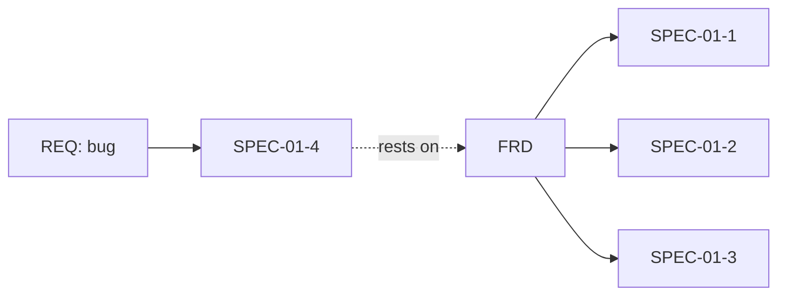

# REQ-1: Small specs one small agent finishes

Status: Accepted

## Summary

Delegated work fails when a small model gets a large spec and FRD and drifts, and a hand-written brief fails because it paraphrases the source and goes stale. The owner asks for specs small enough that one small agent finishes each from start to end, in one format shared by the builder, the reviewer, fixes, small changes and work that is not product, such as CI.

Last change: 2026-11-20, opened; covers work that is not product, such as CI; accepted

## Who asked and when
The owner, 2026-11-20, in a working session on how work is handed to agents.

## What they said
> If we do that, a Haiku runs out of context and starts to wander with big specs and FRDs. I think we should hand over small specs, even if there are more of them, something a small agent could do from start to end.

> The code reviewer should be able to work from that too, and fixes and small things should use this same format. (Translated from Spanish.)

## The problem behind it
Two ways of handing work over fail today:
- A pointer to a large spec and FRD: a small model loses the thread and adds work nobody asked for.
- A brief written by the lead: it paraphrases the FRD, changes its meaning, sets the wrong goal ("make the lint pass" instead of "the replay is real") and goes stale when the FRD changes. In the owner's monorepo, work is handed over as briefs, and 94% of changes are returned at least once (D-19).

The spec template allows 250 lines and any number of files and ids, so nothing keeps a spec small.

## Evidence
Seen in this repository's own team runs on 2026-11-20: a builder removed backticks to pass the replay lint instead of shipping the real fixture, and a test for FRD-01/EX-1 passed against a broken implementation until a mutant caught it. Whether a small model finishes a spec within the proposed caps is unknown until the first measured run.

## Proposal
One level, no sub-spec and no brief: the small spec is the hand-over.

- **Caps, checked:** about 80 lines, at most 3 files, exactly one done command. The quoted rows count toward the lines, so no separate cap on ids. Values to tune from run metrics (D-7).
- **Self-contained:** the spec quotes the FRD rows it covers, verbatim, generated by a command; the check fails a quote that differs from the FRD, and drift marks the spec suspect when the FRD changes. The copy lint accepts a marked verbatim quote.
- **Split by a large model, run by a small one:** a stronger model splits an FRD into small specs in dependency order; `trace` fails when the specs together leave an FRD id uncovered.
- **Review from the same spec:** the quoted rows are the acceptance criteria, the file list is the scope (a changed file outside it fails), and the done command is the gate.
- **Fixes and small changes use the same format:** a spec on the short path (D-1) resting on an existing FRD. A bug the FRD's examples already forbid quotes that row; a bug no example covers first adds an example to the FRD for the owner to approve.
- **Work that is not product:** CI, infrastructure, dependencies and refactors use the same small spec; only the parent changes. A spec rests on an FRD (behavior), a TP or ADR (a technical decision), a CHECKS or INVARIANTS row (a process rule) or an accepted request alone (a chore), and quotes the rows of that parent. A failure that repeats goes through the retro and becomes a CHECKS row first.
- **Too big:** a spec over a cap is split again; the small agent never gets more context.

## Decision
Accepted by the owner 2026-11-20 into the chain slice as R-CHAIN-26 and R-CHAIN-27; mechanism in L-15.
