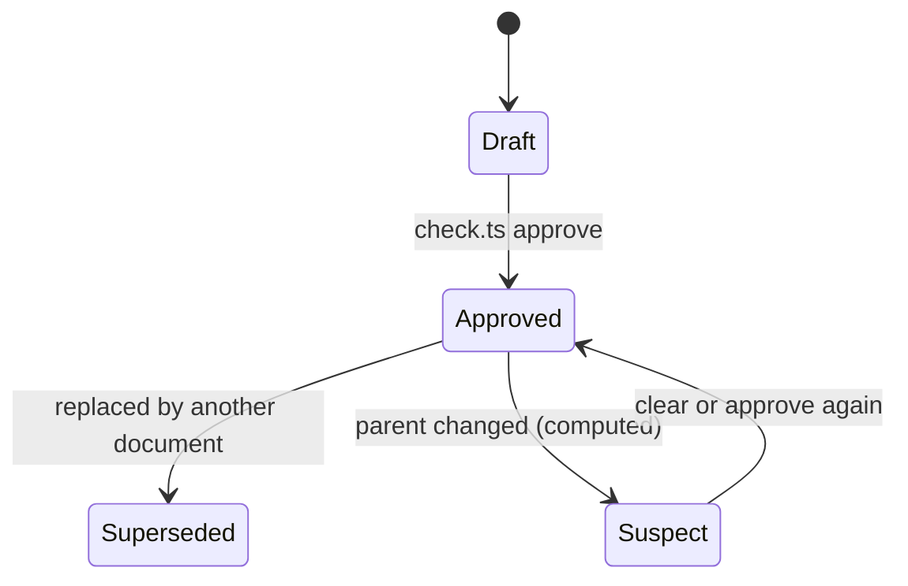

# REQ-2: Superseded documents and a computed Done

Status: Accepted

## Summary

A chain document that is replaced has no way to say so: it stays Approved and keeps demanding test coverage. The owner asks how active, draft and superseded documents are handled. Proposal: one written state more, `Superseded by <path>`, for every chain document, and Done for specs computed, never written.

Last change: 2026-11-20, opened; accepted

## Who asked and when
The owner, 2026-11-20, in a working session on small specs (REQ-1).

## What they said
> And how are states handled? Whether something is active, or draft, or superseded. (Translated from Spanish.)

## The problem behind it
Today PRODUCT, PRD, FRD, UX, TP and spec allow only `Draft` and `Approved (date)`. ADRs have `Superseded` and requests have `Merged into REQ-n`, but the rest of the chain does not. A replaced FRD or spec stays Approved, so `trace` fails its untested examples and drift keeps checking it. Deleting it breaks the links that point to it and hides why it was replaced.

With small specs (REQ-1) there are many specs, and nothing says which are finished.

## Evidence
Seen while designing REQ-1, 2026-11-20. How often a document is replaced is unknown.

## Proposal
Written states stay few; everything that can be computed is computed, so it cannot go stale.

- **Superseded, written:** `Status: Superseded by <path> (YYYY-MM-DD)` for every chain document. The lint fails when the path does not exist. `status` lists superseded documents apart; `trace` and drift skip them.
- **Done, computed for specs:** a spec is Done when it is approved, its done command passes and `trace` covers its ids. `check.ts done` computes it; hooks never run it. When the code breaks later, the spec stops being Done without anyone editing it.
- **No Active state:** active means Approved without drift; a separate written state would be one more thing kept by hand.

## Decision
Accepted by the owner 2026-11-20 into the chain slice as R-CHAIN-28; mechanism in L-15.
