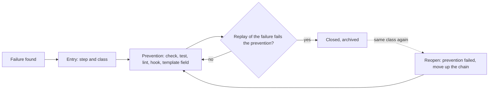

# Research and proposed model: templates, tests, consistency, retro

Date: 2026-11-20. Three researcher agents plus a read of the retro and decision logs of a production monorepo of about 8,500 files (backend, web, landing, mobile). Practice: what a team says it does. Evidence: measured. Most 2026 sources are arXiv preprints, several read only as abstracts.

## Summary

- No requirement format (EARS, Gherkin, prose) is proven better for LLM test generation. What helps: constrained input, enumerable cases (tables), human-approved examples as the oracle, and ids that every test must cite.
- Tests written after the code copy its faults: fault detection 14% when tests were written after faulty code, 25% when written independently (arXiv 2607.05139). Grounding the tester in the spec recovered 27 of 30 bugs against 2 of 30 without it, and false alarms fell from 33% to 0% (arXiv 2607.06636). Grounding matters more than a separate author; a separate step without the code in context is the cheap bet.
- Coverage is a weak gate: one suite had 100% coverage and a 4% mutation score (MutGen, arXiv 2506.02954). Meta's ACH generated tests to kill mutants a human concern described; engineers accepted 73% (arXiv 2501.12862).
- Rules in prose do not hold. That monorepo's retro log has 683 entries in 9,131 lines (1 MB); its class `process-state` has recurred 157 times. Its rule "an entry closes only when its fix is mechanical" is right, but fixes are made per entry, not per class, and nothing proves the fix would catch the original failure.

## Proposed FRD model (one template holds everything)

Every row has an id. Tests, specs and review findings cite the ids. A check fails on an id with no test and on a test with no id.

| Section | Holds | Ids | Becomes |
|---|---|---|---|
| Summary | Five lines: what, for whom, what matters most | | |
| Why | The request notes it answers | REQ-n | |
| Requirements covered | PRD requirements | R-SLICE-n | coverage check |
| Behavior | One EARS sentence per row, tagged WHEN, WHILE, IF/THEN, WHERE or always; more than three conditions moves to a decision table | FR-NN-n | |
| Rules and examples | Each rule with at least one positive and one negative or boundary example, concrete input and expected output, approved by the owner. These are the oracle | RULE-n, EX-n | one test per EX |
| Decision table | Combinations of conditions, when they exist; else "n/a: reason" | DT-n | one test per row |
| States | Lifecycle with illegal transitions, when it exists; else "n/a: reason" | ST-n | one test per cell |
| Invariants | What must always hold, linked to the product catalog | INV-n | property test or assert |
| Quality criteria | The nine ISO/IEC 25010:2023 characteristics, each measurable (metric, threshold, how measured) or "n/a: reason"; "fast" or "secure" fails | QC-n | a gate or marked manual |
| Cross-cutting | Each row of the product registry (security, privacy, accessibility, i18n, performance): applies or "n/a: reason" | CC-n | |
| Open questions | Must be empty to approve | Q-n | |
| Acceptance criteria | Given/When/Then generated from the examples, never written by hand | AC-n | the executable tests |
| Trace | Generated: id, tests, mutation result | | trace check |

Diagram in each FRD when a flow or a state machine exists (Mermaid).

## Proposed test model

1. Tests come from the FRD ids, before any code, in a step that does not see the implementation.
2. Some examples are held out: the implementer never sees them; the gate runs them.
3. Each test names its id; the trace check fails both ways.
4. No test without an assertion; mocks only at the system boundary.
5. Mutation gate on the changed lines, with a threshold that starts below the measured baseline and only rises. A surviving mutant is reported as "a missing rule or a weak assertion". Tool per stack (Stryker for TypeScript; Bun support unverified).
6. Property tests only for invariant rows.
7. A change that modifies a test that used to pass is flagged in review.

## Proposed consistency model

- Glossary with an `avoid` column; a check fails on a banned synonym in documents, code names and test names.
- Invariants catalog: each invariant names an executable check (property test, architecture rule, lint rule). A prose-only invariant fails.
- Cross-cutting registry: every FRD answers each row.
- Contracts between slices: an interface change names its contract test in the TP.
- UX: design tokens by name; token lint and visual snapshots for changed components.
- Rule files short and scoped by folder; rules that cannot have exceptions are hooks, not text.

## Proposed retro model

An entry is not closed by a lesson. It is closed by a prevention that is proven.

1. The entry names the chain step that should have caught the failure, and a narrow class.
2. It is closed only with a prevention artifact (a check, test, lint rule, hook or template field) and a replay: the original failure, replayed as a fixture or mutant, now fails that artifact. The same rule Scriptorium uses for its own checks: good input passes, the mutant fails.
3. A class that keeps growing (157 in that monorepo) is too broad: past a set count it must be split, so each part can have one prevention.
4. A recurrence after closure reopens the entry and marks its prevention as failed; the next fix moves up the chain (a template field or a gate), never another prose rule.
5. The log holds only open entries, with a line cap; closed ones go to the monthly archive.
6. The retro measures itself: recurrence after a fix, per class.

## Sources

- Self-testing: https://arxiv.org/abs/2607.05139 ; https://arxiv.org/abs/2607.22883 ; https://arxiv.org/abs/2607.06636 ; https://arxiv.org/abs/2610.11835 ; https://arxiv.org/abs/2606.28430 ; mocks https://arxiv.org/abs/2602.00409 ; print-only tests https://arxiv.org/abs/2602.07900
- Mutation: Meta ACH https://arxiv.org/abs/2501.12862 ; MutGen https://arxiv.org/abs/2506.02954 ; LLMorpheus https://arxiv.org/html/2404.09952 ; Stryker https://stryker-mutator.io/docs/stryker-js/incremental/ ; cargo-mutants https://mutants.rs/in-diff.html
- Property tests: https://arxiv.org/abs/2510.25297 ; https://arxiv.org/abs/2510.09907 ; https://arxiv.org/abs/2611.15920
- Formats: Example Mapping https://cucumber.io/blog/bdd/example-mapping-introduction/ ; Kiro EARS https://kiro.dev/docs/specs/feature-specs/ ; ISO 25010:2023 https://quality.arc42.org/articles/iso-25010-update-2023 ; BDD generation https://arxiv.org/abs/2603.04729 , https://arxiv.org/abs/2504.07244 , https://arxiv.org/abs/2607.01980 ; oracles https://arxiv.org/abs/2607.10277 , https://arxiv.org/abs/2610.05001 ; survey https://arxiv.org/abs/2606.06563
- Consistency: context files https://arxiv.org/abs/2602.11988 , https://arxiv.org/abs/2511.12884 ; constraint violations https://arxiv.org/abs/2603.03456 ; fitness functions (Ford et al., 2022) ; ArchUnit with agents https://jdriven.com/blog/2026/10/ArchUnit-in-the-Age-of-Agentic-Development ; Pact https://docs.pact.io/getting_started/how_pact_works ; Claude Code memory and hooks https://code.claude.com/docs/en/memory

## Open doubts

- No study ties any of these to a lower rework rate. Measure before and after on Scriptorium's own FRDs and on the monorepo.
- Nine ISO rows may become rubber-stamped "n/a"; audit a sample.
- Mutation cost and tool support for Bun are unverified.
- Whether a separate test author adds value beyond grounding is untested.
