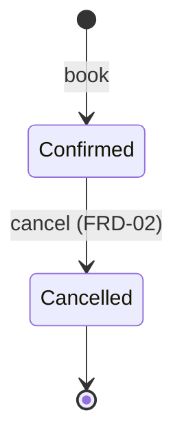

# FRD-01: Book a slot

Status: Approved (2026-11-18)

## Summary

A signed-in family picks a slot with free places and books it. Each family holds one booking per week (Monday to Sunday), a slot never takes more families than it has places, and a slot that has started cannot be booked. Messages follow the family's language. The examples below are the oracle the owner approved.

Last change: 2026-11-18, added the started-slot rule after RETRO-1

One feature of the [slice PRD](../PRD.md). No technology names. Every row has an id; tests, specs and review findings cite the ids.

## Why
[REQ-1](../../requests/REQ-1-book-a-pickup-slot.md).

## Requirements covered
R-PICKUPS-1, R-PICKUPS-3, R-PICKUPS-4.

## Behavior

| ID | Pattern | Requirement |
|---|---|---|
| FR-PICKUPS-01-1 | WHEN | WHEN a family chooses a slot with free places, the system shall create the booking and reduce the slot's free places by one. |
| FR-PICKUPS-01-2 | IF | IF the family already has a confirmed booking in the same week THEN the system shall refuse the new booking and say "One booking per week". |
| FR-PICKUPS-01-3 | WHILE | WHILE a slot has no free places, the system shall show it as full and shall not offer it for booking. |
| FR-PICKUPS-01-4 | WHEN | WHEN two families choose the last free place at the same moment, the system shall confirm one booking and refuse the other with "This slot is full". |
| FR-PICKUPS-01-5 | WHERE | WHERE the family's language is Spanish, the system shall show every booking message in Spanish. |
| FR-PICKUPS-01-6 | always | The system shall always show slot times in the pantry's time zone. |
| FR-PICKUPS-01-7 | IF | IF the slot's start time is not later than the current time THEN the system shall refuse the booking and say "This slot has started". |

## Rules and examples

| Rule | Text | Covers |
|---|---|---|
| RULE-1 | A family holds at most one confirmed booking per week; the week runs Monday 00:00 to Sunday 23:59, pantry time. | FR-PICKUPS-01-2 |
| RULE-2 | A slot's confirmed bookings never exceed its places. | FR-PICKUPS-01-1, FR-PICKUPS-01-3, FR-PICKUPS-01-4 |
| RULE-3 | A slot whose start time is not later than now cannot be booked. | FR-PICKUPS-01-7 |
| RULE-4 | Every message is in the family's language. | FR-PICKUPS-01-5 |

| Example | Rule | Kind | Given | When | Then |
|---|---|---|---|---|---|
| EX-1 | RULE-1 | positive | The Diaz family has no booking in the week of Monday 2026-11-23; Tuesday 10:00 has 5 places and 2 bookings | The family books Tuesday 2026-11-24 10:00 | The booking is confirmed and the slot shows 2 free places |
| EX-2 | RULE-1 | negative | The Diaz family holds a confirmed booking for Tuesday 2026-11-24 10:00 | It books Thursday 2026-11-26 14:00 | The booking is refused with "One booking per week" and Thursday's free places do not change |
| EX-3 | RULE-1 | boundary | The Diaz family holds a booking for Sunday 2026-11-22 18:00 | It books Monday 2026-11-23 09:00 | The booking is confirmed: Monday starts a new week |
| EX-4 | RULE-2 | positive | Wednesday 2026-11-25 10:00 has 5 places and 4 bookings | The Okafor family books it | The booking is confirmed and the slot shows 0 free places and "Full" |
| EX-5 | RULE-2 | boundary | Wednesday 2026-11-25 10:00 has 5 places and 5 bookings | The Lin family tries to book it | The booking is refused with "This slot is full" and the slot keeps 5 bookings |
| EX-6 | RULE-2 | negative | Wednesday 2026-11-25 11:00 has 5 places and 4 bookings | The Okafor and Lin families choose it at the same moment | Exactly one booking is confirmed, the other family sees "This slot is full", and the slot holds 5 bookings |
| EX-7 | RULE-3 | positive | It is Wednesday 2026-11-25 09:59 and the Lin family has no booking that week | It books Wednesday 10:00 | The booking is confirmed |
| EX-8 | RULE-3 | boundary | It is Wednesday 2026-11-25 10:00 and the Lin family has no booking that week | It books Wednesday 10:00 | The booking is refused with "This slot has started" |
| EX-9 | RULE-4 | positive | The Perez family uses Spanish and has no booking that week | It books Wednesday 2026-11-25 10:00 | The message reads "Reserva confirmada: miércoles 25 de noviembre, 10:00" |
| EX-10 | RULE-4 | negative | The Perez family uses Spanish and holds a booking for that week | It books another slot | The message reads "Solo una reserva por semana" and no English text appears |

## Decision table
Three conditions decide the result. The first row that matches wins, top to bottom.

| ID | Slot has started | Slot has free places | Family has a booking this week | Result |
|---|---|---|---|---|
| DT-1 | no | yes | no | Book it |
| DT-2 | no | yes | yes | Refuse: "One booking per week" |
| DT-3 | no | no | no | Refuse: "This slot is full" |
| DT-4 | no | no | yes | Refuse: "One booking per week" |
| DT-5 | yes | any | any | Refuse: "This slot has started" |

## States
A booking exists only once confirmed; a cancelled booking is never revived (a new one is made instead).

| ID | Transition | Allowed |
|---|---|---|
| ST-1 | No booking to Confirmed | Yes, when the decision table says "Book it" |
| ST-2 | Confirmed to Confirmed (a second booking in the week) | No |
| ST-3 | Cancelled to Confirmed | No: booking again creates a new booking |

## Invariants
- INV-1: confirmed bookings of a slot never exceed its places.
- INV-2: a family has at most one confirmed booking per week.
- INV-3: free places equal places minus confirmed bookings.

All three are listed with their checks in [INVARIANTS.md](../../INVARIANTS.md).

## Quality criteria

| ID | Characteristic (ISO/IEC 25010) | Criterion |
|---|---|---|
| QC-1 | Functional suitability | All 10 examples pass in the acceptance run: 10 of 10, measured in CI. |
| QC-2 | Performance efficiency | The slot list shows in under 1 s at p95 with 200 slots, measured in the end-to-end run. |
| QC-3 | Compatibility | n/a: the feature exchanges data with no other system. |
| QC-4 | Interaction capability | A first-time family books in at most 4 taps from the slot list, counted in the UX walk-through. |
| QC-5 | Reliability | With 50 families choosing the last place at once, bookings never exceed places in 1,000 runs. |
| QC-6 | Security | A request for another family's booking returns "not found" in 100% of the access tests. |
| QC-7 | Maintainability | n/a: the project-wide gates in CHECKS.md already cover it. |
| QC-8 | Flexibility | The places of a slot are a setting: changing them needs no code change, shown by one test. |
| QC-9 | Safety | n/a: a failed booking costs a family a trip at worst and endangers nobody. |

## Cross-cutting
- CC-1 applies: a family books only for itself, checked against the signed-in family.
- CC-2 applies: the booking screen shows only the signed-in family's name.
- CC-3 applies: the slot list and the Book button work by keyboard and screen reader.
- CC-4 applies: every message exists in English and Spanish (FR-PICKUPS-01-5).
- CC-5 applies: QC-2 is the budget for the slot list.

## Information
A booking holds the family, the slot and its state. A slot holds its date, start time, places and free places. A family holds its name and language.

## Open questions
None.

## Acceptance criteria
Generated from the examples, decision table and states; never edited by hand.

- **AC-1** (EX-1): Given The Diaz family has no booking in the week of Monday 2026-11-23; Tuesday 10:00 has 5 places and 2 bookings, when the family books Tuesday 2026-11-24 10:00, then the booking is confirmed and the slot shows 2 free places.
- **AC-2** (EX-2): Given The Diaz family holds a confirmed booking for Tuesday 2026-11-24 10:00, when it books Thursday 2026-11-26 14:00, then the booking is refused with "One booking per week" and Thursday's free places do not change.
- **AC-3** (EX-3): Given The Diaz family holds a booking for Sunday 2026-11-22 18:00, when it books Monday 2026-11-23 09:00, then the booking is confirmed.
- **AC-4** (EX-4): Given Wednesday 2026-11-25 10:00 has 5 places and 4 bookings, when the Okafor family books it, then the booking is confirmed and the slot shows 0 free places.
- **AC-5** (EX-5): Given Wednesday 2026-11-25 10:00 has 5 places and 5 bookings, when the Lin family tries to book it, then the booking is refused with "This slot is full".
- **AC-6** (EX-6): Given Wednesday 2026-11-25 11:00 has 5 places and 4 bookings, when two families choose it at the same moment, then exactly one booking is confirmed and the slot holds 5 bookings.
- **AC-7** (EX-7): Given it is Wednesday 2026-11-25 09:59 and the Lin family has no booking that week, when it books Wednesday 10:00, then the booking is confirmed.
- **AC-8** (EX-8): Given it is Wednesday 2026-11-25 10:00, when the Lin family books Wednesday 10:00, then the booking is refused with "This slot has started".
- **AC-9** (EX-9): Given the Perez family uses Spanish, when it books Wednesday 2026-11-25 10:00, then the message is "Reserva confirmada: miércoles 25 de noviembre, 10:00".
- **AC-10** (EX-10): Given the Perez family uses Spanish and holds a booking that week, when it books another slot, then the message is "Solo una reserva por semana".
- **AC-11** (DT-1): Given the slot has not started, has free places, and the family has no booking this week, when the family books, then the booking is created.
- **AC-12** (DT-2): Given the slot has not started, has free places, and the family has a booking this week, when the family books, then the booking is refused with "One booking per week".
- **AC-13** (DT-3): Given the slot has not started, is full, and the family has no booking this week, when the family books, then the booking is refused with "This slot is full".
- **AC-14** (DT-4): Given the slot has not started, is full, and the family has a booking this week, when the family books, then the booking is refused with "One booking per week".
- **AC-15** (DT-5): Given the slot has started, when the family books, then the booking is refused with "This slot has started".
- **AC-16** (ST-1): Given the family has no booking, when the decision table says "Book it", then a Confirmed booking exists.
- **AC-17** (ST-2): Given the family holds a Confirmed booking this week, when it books again, then no second Confirmed booking exists.
- **AC-18** (ST-3): Given a booking is Cancelled, when the family books the same slot again, then a new Confirmed booking is created and the Cancelled one stays Cancelled.
