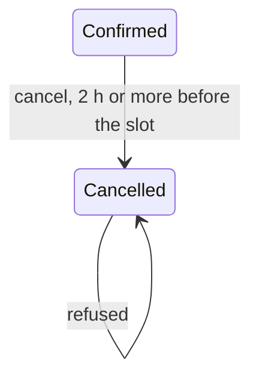

# FRD-02: Cancel a booking

Status: Draft

## Summary

A family gives back a confirmed booking until two hours before the slot starts, and the place becomes free for another family. A booking cancels once; a cancelled booking does not count toward the weekly limit. Messages follow the family's language. One question is open: whether a volunteer can cancel for a family.

Last change: 2026-11-19, first draft with seven examples and one open question

One feature of the [slice PRD](../PRD.md). No technology names. Every row has an id; tests, specs and review findings cite the ids.

## Why
[REQ-1](../../requests/REQ-1-book-a-pickup-slot.md); decision D-3 in [DECISIONS.md](../../DECISIONS.md).

## Requirements covered
R-PICKUPS-2, R-PICKUPS-4.

## Behavior

| ID | Pattern | Requirement |
|---|---|---|
| FR-PICKUPS-02-1 | WHEN | WHEN a family cancels a confirmed booking at least two hours before the slot starts, the system shall cancel it and add one free place to the slot. |
| FR-PICKUPS-02-2 | IF | IF the slot starts in less than two hours THEN the system shall refuse the cancellation and say "Too late to cancel, please ask a volunteer". |
| FR-PICKUPS-02-3 | IF | IF the booking is already cancelled THEN the system shall refuse the request, say "Booking already cancelled" and leave the free places unchanged. |
| FR-PICKUPS-02-4 | WHILE | WHILE a family's only booking of the week is cancelled, the system shall let the family book again that week. |
| FR-PICKUPS-02-5 | WHERE | WHERE the family's language is Spanish, the system shall show every cancellation message in Spanish. |

## Rules and examples

| Rule | Text | Covers |
|---|---|---|
| RULE-1 | A family may cancel until exactly two hours before the slot starts. | FR-PICKUPS-02-1, FR-PICKUPS-02-2 |
| RULE-2 | A cancellation frees exactly one place, once. | FR-PICKUPS-02-1, FR-PICKUPS-02-3 |
| RULE-3 | A cancelled booking does not count toward the one booking per week. | FR-PICKUPS-02-4 |

| Example | Rule | Kind | Given | When | Then |
|---|---|---|---|---|---|
| EX-1 | RULE-1 | positive | The Diaz family holds a booking for Wednesday 2026-11-25 10:00; it is Tuesday 18:00 | It cancels | The booking is cancelled |
| EX-2 | RULE-1 | boundary | The same booking; it is Wednesday 08:00 | It cancels | The booking is cancelled: exactly two hours remain |
| EX-3 | RULE-1 | negative | The same booking; it is Wednesday 08:01 | It cancels | The cancellation is refused with "Too late to cancel, please ask a volunteer" |
| EX-4 | RULE-2 | positive | Thursday 2026-11-26 14:00 has 5 places and 5 bookings, including the Diaz booking | The Diaz family cancels on Wednesday | The slot holds 4 bookings, shows 1 free place and is offered again |
| EX-5 | RULE-2 | negative | The Diaz booking is already cancelled and the slot shows 1 free place | The family sends the cancellation again | It is refused with "Booking already cancelled" and the slot still shows 1 free place |
| EX-6 | RULE-3 | positive | The Diaz family cancelled its Tuesday 2026-11-24 booking | It books Thursday 2026-11-26 14:00 | The booking is confirmed |
| EX-7 | RULE-3 | negative | The Diaz family cancelled Tuesday's booking and holds a confirmed Thursday booking | It books Friday 2026-11-27 11:00 | The booking is refused with "One booking per week" |

## Decision table
n/a: one condition (the time left) decides, and RULE-1 states it with its boundary.

## States

| ID | Transition | Allowed |
|---|---|---|
| ST-1 | Confirmed to Cancelled | Yes, at least two hours before the slot |
| ST-2 | Cancelled to Cancelled | No: the request is refused |
| ST-3 | Cancelled to Confirmed | No: booking again creates a new booking (FRD-01) |

## Invariants
- INV-1: cancelling lowers a slot's bookings and so never breaks the places limit.
- INV-3: after a cancellation, free places equal places minus confirmed bookings.

Both are listed with their checks in [INVARIANTS.md](../../INVARIANTS.md).

## Quality criteria

| ID | Characteristic (ISO/IEC 25010) | Criterion |
|---|---|---|
| QC-1 | Functional suitability | All 7 examples pass in the acceptance run: 7 of 7, measured in CI. |
| QC-2 | Performance efficiency | A cancellation is confirmed in under 500 ms at p95, measured in the end-to-end run. |
| QC-3 | Compatibility | n/a: the feature exchanges data with no other system. |
| QC-4 | Interaction capability | A family cancels in at most 3 taps from its booking, counted in the UX walk-through. |
| QC-5 | Reliability | When the same cancellation arrives twice within 1 s, exactly one place is freed in 1,000 runs. |
| QC-6 | Security | Cancelling another family's booking returns "not found" in 100% of the access tests. |
| QC-7 | Maintainability | n/a: the project-wide gates in CHECKS.md already cover it. |
| QC-8 | Flexibility | n/a: the two-hour limit is fixed by decision D-3 until the coordinator asks otherwise. |
| QC-9 | Safety | n/a: a wrongly refused cancellation costs a family a trip at worst. |

## Cross-cutting
- CC-1 applies: a family cancels only its own bookings.
- CC-2 applies: the cancel screen shows only the signed-in family's name.
- CC-3 applies: the Cancel button works by keyboard and screen reader.
- CC-4 applies: every cancellation message exists in English and Spanish (FR-PICKUPS-02-5).
- CC-5 applies: QC-2 is the budget for the cancellation.

## Information
A cancellation changes the booking's state and adds one free place to its slot. The family and slot are the ones of the booking.

## Open questions
- Q-1: May a volunteer cancel a booking on behalf of a family that phones the pantry? Recommendation: no in this slice; it needs a volunteer role that PRD non-goals leave out.

## Acceptance criteria
Generated from the examples and states; never edited by hand.

- **AC-1** (EX-1): Given the Diaz family holds a booking for Wednesday 2026-11-25 10:00 and it is Tuesday 18:00, when it cancels, then the booking is cancelled.
- **AC-2** (EX-2): Given the same booking and it is Wednesday 08:00, when it cancels, then the booking is cancelled.
- **AC-3** (EX-3): Given the same booking and it is Wednesday 08:01, when it cancels, then the cancellation is refused with "Too late to cancel, please ask a volunteer".
- **AC-4** (EX-4): Given Thursday 2026-11-26 14:00 has 5 places and 5 bookings, including the Diaz booking, when the Diaz family cancels on Wednesday, then the slot holds 4 bookings and shows 1 free place.
- **AC-5** (EX-5): Given the Diaz booking is already cancelled and the slot shows 1 free place, when the family sends the cancellation again, then it is refused with "Booking already cancelled" and the slot still shows 1 free place.
- **AC-6** (EX-6): Given the Diaz family cancelled its Tuesday 2026-11-24 booking, when it books Thursday 2026-11-26 14:00, then the booking is confirmed.
- **AC-7** (EX-7): Given the Diaz family cancelled Tuesday's booking and holds a confirmed Thursday booking, when it books Friday 2026-11-27 11:00, then the booking is refused with "One booking per week".
- **AC-8** (ST-1): Given a Confirmed booking and at least two hours before the slot, when the family cancels, then the booking is Cancelled.
- **AC-9** (ST-2): Given a Cancelled booking, when the family cancels again, then the request is refused.
- **AC-10** (ST-3): Given a Cancelled booking, when the family books the same slot, then a new booking is created and the Cancelled one stays Cancelled.
