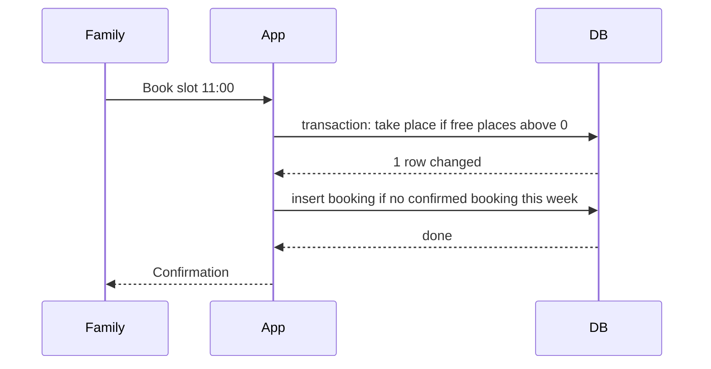

# Technical Proposal: Book a slot

Status: Draft

## Summary

Booking takes the last place with one conditional update inside a transaction, so two families cannot both win (FR-PICKUPS-01-4). Times are stored in UTC and the week is computed in the pantry's time zone. Nothing here needs its own ADR: both choices follow ADR-001.

Last change: 2026-11-19, two decisions with their options

Rests on [FRD-01](../frd/FRD-01-book-a-slot.md) and [UX-01](../ux/UX-01-book-a-slot.md); the cross-cutting choices are in [the cross-cutting TP](../../tp/TP.md).

## Context
FR-PICKUPS-01-1, FR-PICKUPS-01-2 and FR-PICKUPS-01-4 need an atomic check of free places and of the family's week. FR-PICKUPS-01-6 and FR-PICKUPS-01-7 need times in the pantry's zone. Storage is the file-based database of ADR-001, one writer at a time. Fact: SQLite runs a write transaction alone, so a conditional update cannot interleave with another.

## Decisions
### TD-1: How to stop two families taking the last place
- **Option A** Read the free places, then write the booking in the application code. Two requests can both read "1 free" and both write: INV-1 breaks about once in a few hundred concurrent attempts in a prototype.
- **Option B** One conditional update: take a place only when free places are above zero, and insert the booking in the same transaction; zero changed rows means "This slot is full". No race, no extra lock.

Chosen: Option B, because it makes INV-1 true by construction. ADR: none: it applies ADR-001 and decides nothing the whole system depends on.

### TD-2: How to store times and compute the week
- **Option A** Store local time. Simple to read, wrong twice a year when the clocks change: a slot at 10:00 can appear twice or never.
- **Option B** Store UTC and convert with the pantry's zone setting; the week runs Monday to Sunday in that zone.

Chosen: Option B, because EX-3 and EX-8 depend on exact boundaries. ADR: none: the choice is local to this feature.

## Architecture

## Information
Table `slot`: id, starts_at (UTC), places, free_places. Table `booking`: id, family_id, slot_id, week_start (UTC date of the Monday), state. A unique index on (family_id, week_start) for confirmed bookings makes INV-2 hold even if the code is wrong.

## Interfaces and contracts
`book(familyId, slotId, now) -> Booking | Refusal` where a refusal is one of `one-per-week`, `slot-full`, `slot-started`. Contract test: every refusal maps to its message in both languages (CC-4).

## Threat model
A family sends another family's id: the app ignores any id in the request and uses the signed-in family (CC-1). Replaying a booking request books nothing a second time: the unique index refuses it.

## Testing
EX-1 to EX-10, DT-1 to DT-5 and ST-1 to ST-3 become tests first, written without the code in view; EX-6 is a concurrency test with 50 simultaneous requests. INV-1 to INV-3 are property tests over 1,000 random sequences. Mutation scope: `src/pickups/book.ts`.

## Risks
The unique index depends on the week being computed the same way in code and in the index. One shared function computes it, and EX-3 tests the boundary.

## Open questions
None.
