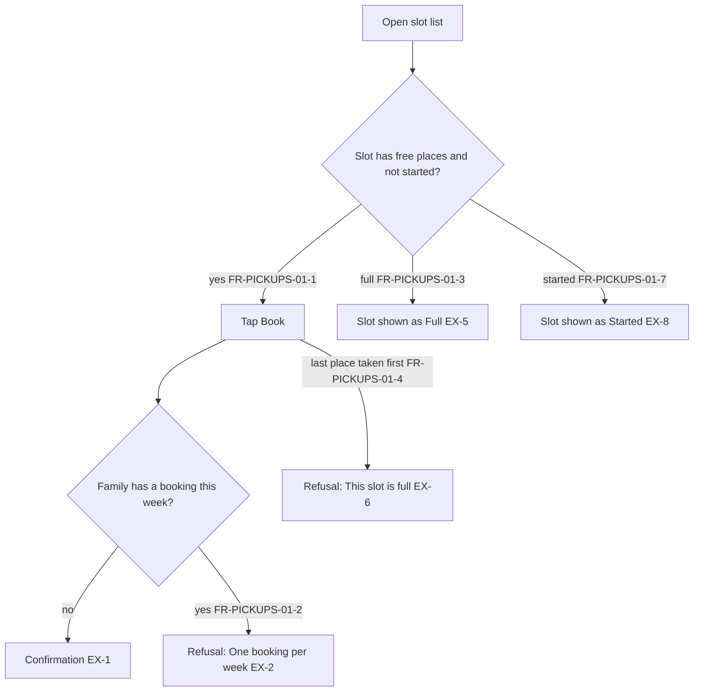

# UX-01: Book a slot

Status: Draft

## Summary

A family opens the slot list for the week, sees which slots have free places, and books one in two taps. Full and started slots are visible but cannot be chosen. The confirmation and every refusal are short messages in the family's language. The screen works at 360 px width and by keyboard.

Last change: 2026-11-19, first draft of flows, screens and states

For [FRD-01](../frd/FRD-01-book-a-slot.md). Written after the FRD, before its TP.

## Flows

## Screens

| Screen | Purpose | FR ids |
|---|---|---|
| Slot list | Show the week's slots with their free places and let the family tap Book | FR-PICKUPS-01-1, FR-PICKUPS-01-3, FR-PICKUPS-01-6, FR-PICKUPS-01-7 |
| Confirmation | Show the booked day and time and a link to the booking | FR-PICKUPS-01-1, FR-PICKUPS-01-5 |
| Refusal message | Say why the booking failed, in one sentence, over the slot list | FR-PICKUPS-01-2, FR-PICKUPS-01-4, FR-PICKUPS-01-7 |

## States

| Screen | Empty | Loading | Error | Partial | Success |
|---|---|---|---|---|---|
| Slot list | "No slots this week. Check again on Monday." | Three grey rows where slots will appear | "We could not load the slots. Try again." and a Retry button; the last list stays visible | Some days load, the rest show a spinner | The list, each row with day, time and free places |
| Confirmation | n/a: it appears only after a booking | The Book button shows a spinner and cannot be tapped twice | "We could not book. Your place is not held." and a Retry button | n/a: a booking is confirmed or it is not | "Booked: Wednesday 25 November, 10:00" |

## Design system

| Component or token | Reused, changed or new | Where |
|---|---|---|
| Button, primary | Reused | Book button on each slot row |
| Slot row | New: no existing row shows a count of free places | Slot list |
| Message banner | Reused | Refusal message and error state |
| Color token `status-full` | New, for the Full label; contrast 4.5 to 1 against the row background | Slot row |

## Accessibility and language

Reading order is day, time, free places, Book. Focus moves to the confirmation message after a booking and to the refusal message after a refusal. Full and Started are written words, never color alone. Spanish labels run about 30% longer than English: "Reservar" is 8 letters against 4 for "Book", so the button grows and the row wraps to two lines at 360 px.

## Open questions
None.
