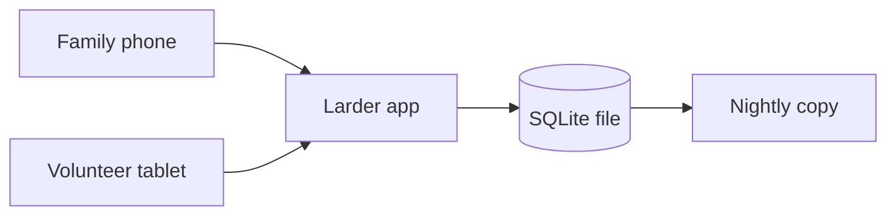

# Technical Proposal: Larder cross-cutting

Status: Draft

## Summary

Larder keeps its data in one file-based database on the pantry's own server, because one pantry serves a few hundred families and one writer at a time is enough. Every feature reads and writes through that store; the first feature that depends on this is booking a slot (FR-PICKUPS-01-4). The choice is recorded in ADR-001.

Last change: 2026-11-19, storage choice written with its ADR

Cross-cutting: written after the FRDs; each slice adds its own TP per FRD.

## Context
The pickups FRDs ask that two families choosing the last place at once cannot both win (FR-PICKUPS-01-4). The pantry has one server, a volunteer who maintains it two hours a week, and about 300 families (illustrative).

## Decisions
### TD-1: Where the data lives
- **Option A** A file-based database (SQLite) on the pantry server: no separate service, backup is copying one file, one writer at a time. Fails when more than one server must write, which the pantry does not plan.
- **Option B** A hosted database service: many writers, but a monthly fee, an outside dependency and a network failure case on every booking.

Chosen: Option A, because one writer is enough and the volunteer can restore a backup alone. ADR: ADR-001.

## Architecture

## Information
One database file holds families, slots, bookings and, later, donations. A nightly copy goes to a second disk.

## Interfaces and contracts
The app is the only reader and writer of the file. A slice's TP defines its own tables and the contract test for each interface it changes.

## Threat model
Assets: families' names and bookings. Attackers: another family guessing a booking address; anyone with access to the server disk. Stops it: every request is checked against the signed-in family (CC-1), the file is readable only by the app account. Accepted: a volunteer with server access can read all names.

## Testing
FRD ids become tests first, written without the code in view. Gates before hand-over: unit and property tests, the access test of CC-1, and a mutation run on changed lines.

## Risks
The single server is a single point of failure: the nightly copy limits loss to one day of bookings, which the coordinator accepts for now.

## Open questions
None.
