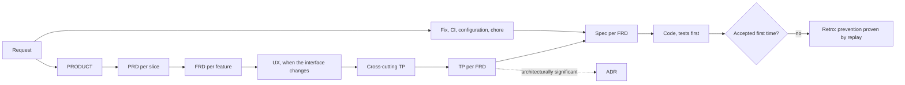

# Scriptorium

Nothing moves to the next document until the current one passes its check and the owner has decided what only the owner can decide.

## The chain



Each document rests on the one before it. A document may be approved only when the one it rests on is approved: PRD on PRODUCT, FRD on its PRD, UX-NN and TP-NN on FRD-NN, a spec on the document its `Rests on:` line names, ADR on the TP that cites it. Only the owner approves.

## Layout

```text
docs/
  PRODUCT.md  GLOSSARY.md  INVARIANTS.md  CROSS-CUTTING.md  CHECKS.md
  DECISIONS.md            decisions not yet absorbed into their document
  decisions/YYYY-MM.md    archive
  requests/REQ-n-name.md
  tp/TP.md                cross-cutting technical proposal
  adr/ADR-NNN-name.md
  retro/RETRO.md          open entries only; retro/YYYY-MM.md archive
  research/
  <slice>/
    PRD.md
    frd/FRD-NN-name.md
    ux/UX-NN-name.md
    tp/TP-NN-name.md
    specs/SPEC-NN-k-name.md   one agent run each
  ops/specs/SPEC-NN-k-name.md CI, configuration, chores
```

`requests`, `tp`, `adr`, `retro`, `decisions` and `research` are not slices. Templates are in `${CLAUDE_PLUGIN_ROOT}/templates/`; the templates are the source of truth for sections and ids.

## Skill per document

| Step | Where | Holds | Skill | Check |
|---|---|---|---|---|
| Product | `docs/PRODUCT.md` | Problem, users, numbered principles, use cases UC-n, scope, slice map | `/scriptorium:init`, or `/scriptorium:adopt` when documents exist | owner approves |
| PRD | `docs/<slice>/PRD.md` | R-SLICE-n, cites UC-n and principles by number | `/scriptorium:prd` | `check.ts prd` |
| FRD | `docs/<slice>/frd/` | EARS rows FR-SLICE-NN-n, rules with positive and negative examples, decision and state tables, invariants, quality criteria QC-1..QC-9 | `/scriptorium:frd` | `check.ts frd` |
| UX | `docs/<slice>/ux/` | Flows, screens, states, design-system components `/scriptorium:ux` | `check.ts ux` |
| Cross-cutting TP | `docs/tp/TP.md` | Written after the FRDs: stack, storage, conventions, threat model | `/scriptorium:tp` | `check.ts tp` |
| TP per FRD | `docs/<slice>/tp/` | Options compared, one chosen, ADR or "none: reason" | `/scriptorium:tp` | `check.ts tp` |
| ADR | `docs/adr/` | One architecturally significant decision | with the TP | `check.ts tp` checks the ADRs in its dir |
| Spec | `docs/<folder>/specs/` | One agent run: rows quoted from its parent, at most 3 files, tests first, one done command; decides nothing new | `/scriptorium:spec` | `check.ts spec <SPEC>` |
| Fix | a spec on an FRD | The broken row, its failing test, the fix | `/scriptorium:fix` | `check.ts spec` |
| CI, configuration, chores | a spec on a TP, ADR, CHECKS row or request | The rule it keeps, one command that reproduces the job | `/scriptorium:ops` | `check.ts spec` |
| Any chain document | | `## Summary` in the first 20 lines, ending with `Last change: YYYY-MM-DD, <what>` | | `check.ts summary <file>` |
| Status | | Every document and where it stands | `/scriptorium:status` | `check.ts status .` |

Every document type has its own skill that teaches how to write it: `/scriptorium:migrate` (move the project to the next format), `/scriptorium:fix`, `/scriptorium:ops`, `/scriptorium:request`, `/scriptorium:decision`, `/scriptorium:glossary`, `/scriptorium:invariant`, `/scriptorium:concern`, `/scriptorium:ux`, `/scriptorium:adr`, and for the rest of the loop `/scriptorium:check` (add a project rule), `/scriptorium:review` (closed review) and `/scriptorium:retro` (turn a failure into a proven prevention). PRD and FRD name no technology. A TP proposes; an ADR decides. Owner decisions go in `docs/DECISIONS.md` the same day; shared terms in `docs/GLOSSARY.md`.

## Short path

A bug or small change does not need a PRD or an FRD. It goes to a small spec that rests on an existing FRD (`/scriptorium:fix`); CI, configuration and chores go to a small spec that rests on a TP, an ADR, a CHECKS row or an accepted request (`/scriptorium:ops`). Only a new feature or a new slice goes through PRD and FRD. If the change touches behavior that has no FRD, offer (never force) to map it from the code into draft documents and report the gaps between what the owner believes and what the code does.

## Checks

Run from the project root, with the checks script from this plugin:

```bash
bun "${CLAUDE_PLUGIN_ROOT}/scripts/check.ts" prd docs/<slice>/PRD.md <SLICE_ID>
bun "${CLAUDE_PLUGIN_ROOT}/scripts/check.ts" frd docs/<slice> <SLICE_ID>
bun "${CLAUDE_PLUGIN_ROOT}/scripts/check.ts" ux docs/<slice>
bun "${CLAUDE_PLUGIN_ROOT}/scripts/check.ts" tp docs/tp/TP.md docs/adr
bun "${CLAUDE_PLUGIN_ROOT}/scripts/check.ts" spec docs/<folder>/specs/SPEC-NN-k-name.md
bun "${CLAUDE_PLUGIN_ROOT}/scripts/check.ts" excerpt <document> <ID>...
bun "${CLAUDE_PLUGIN_ROOT}/scripts/check.ts" done <spec>
bun "${CLAUDE_PLUGIN_ROOT}/scripts/check.ts" summary <document>
bun "${CLAUDE_PLUGIN_ROOT}/scripts/check.ts" status .
```

Exit 0 passes. Exit 1 prints every failure. Exit 2 is a usage error.

## Formats and updates

A project pins the format of its rules in `.scriptorium/config.json` beside `docs/` (no file means format 1, the rules of 0.3.0). An update never changes which rules block a project: a rule from a newer format prints `WARN (format N): ...` until the project migrates with `/scriptorium:migrate`, one format at a time. The checks keep the current and the previous format.

The same checks run outside Claude Code as `bun <scriptorium>/scripts/cli.ts <check|lint|trace|migrate|install|pre-commit>`, where `<scriptorium>` is a checkout or the installed plugin. Never run it as `bunx scriptorium`: that name on the public registry belongs to another project. The git hook runs `$SCRIPTORIUM_CLI`, or the path `install` wrote to `.scriptorium/local`.

## Enforcement

A rule that exists only in prose does not count. Three layers run without the agent choosing to run a check (L-12). Each acts only in a project that has `docs/PRODUCT.md`:

1. **Plugin hooks** (`hooks/hooks.json`): before an edit to code or configuration, `scripts/hook-gate.ts` runs the gate described below; after an edit under `docs/`, `scripts/hook-doc-check.ts` runs that document's check and the docs lint on it; before the agent stops, `scripts/hook-stop.ts` checks the documents changed since HEAD, plus `check.ts status .`. Failures reach the agent with exit 2; if the agent is already continuing because of this hook, it warns and lets it stop.
2. **Git pre-commit** (`scripts/pre-commit.ts`): the same checks on staged documents, for any agent or person. `bun "${CLAUDE_PLUGIN_ROOT}/scripts/cli.ts" install` writes it to `.scriptorium/pre-commit` and points git at that folder, so the hook is committed with the project.
3. **CI** (`.github/workflows/ci.yml`): tests, typecheck, status, lint and the example chain on every pull request.

Before the agent edits code or configuration, a hook refuses the edit unless an approved spec names the file, or an accepted request declares it as a short path, and every FRD row the spec quotes has a test (L-12, D-30, FRD-04). Pre-commit runs the same rule on staged files. Where `.changeset/config.json` exists, pre-commit fails a commit that changes code without a changeset (L-15).

Project rules learned from a failure live in `docs/CHECKS.md`: id, what it prevents, the command, and the replay of the failure it catches; a row without a command fails (`/scriptorium:check`). Documents are linted by `bun "${CLAUDE_PLUGIN_ROOT}/scripts/lint-docs.ts" .` (banned phrases, dead links, filler sections, line caps, empty registry cells, copied text).

## Why the process

Rework is a queue in `docs/metrics/rework.md`: open findings only, each with one cause and the step that should have caught it (D-32). On the first runs, review found no change built against its spec; most findings were examples the FRD or the spec lacked. So the order is fixed, and each step exists for a measured reason (L-17):

1. **An approved spec before any code.** A rule in prose did not hold: the lead and two builders edited code outside a spec on the same day. The edit hook now refuses it.
2. **Tests from the spec, by a tester who has not seen the code.** Tests written after the code copy its faults; a tester grounded in the spec found 27 of 30 bugs against 2 of 30 ([research](../../docs/research/2026-11-20-templates-tests-consistency.md)).
3. **The builder makes them pass and never edits them.** A wrong test goes back to the lead.
4. **Review against the spec only, with mutants.** A surviving mutant is a missing row. Review never invents scope; a gap it finds is a finding against the spec, logged with its step.
5. **Every finding goes in the rework queue with one cause.** A cause found twice with no prevention blocks, and so does a prevented cause that comes back. The queue only holds open findings, so it shrinks when the process improves.

## With a team

Run each step as an agent team, following [puppeteering](https://github.com/antonygiomarxdev/puppeteering): researchers write, an independent reviewer reviews against the step above, the lead verifies by re-running the check and asks the owner only what is the owner's to decide.

- Give each writer its slices in its spawn prompt and set each task's owner before spawning. Writers never claim other tasks.
- One file has one writer.
- After the per-slice reviews, run one cross-slice review over the whole step.
- Record every owner answer in `docs/DECISIONS.md` the same day.

## Reviewing a TP or ADR

The check only sees structure. A reviewer also looks for these, because the check passed on all of them in Deputy:

- **Hand-rolled where a maintained library exists** (phone numbers, dates and time zones, CSV, JWT, crypto, migrations). Name the library, and verify that it is maintained and runs on the project's runtime.
- **Alternatives rejected without a concrete reason.** "Adds a dependency", "large" or "complex" with no number or failure case is not a reason.
- **Hidden single-user assumptions:** one country, language, time zone, currency or number format, or an example from the FRD treated as the rule.
- **Numbers with no stated reason:** limits, timeouts, intervals, caps.
- **Facts about tools that may be out of date.** Check the current docs before rejecting an option for lacking a feature.

## Status and approval

Every chain document carries one status line. PRODUCT, PRD, FRD, UX, TP and spec use `Status: Draft`, `Status: Approved (YYYY-MM-DD)` or `Status: Superseded by <relative path> (YYYY-MM-DD)`; a request uses `Open`, `Accepted`, `Rejected` or `Merged into REQ-m`. ADRs use `## Status` followed by `Proposed`, `Accepted`, `Superseded` or `Rejected`.

Nothing advances with an open question. A document is approved only with no Q-n left in its Open questions; when an answer is unclear, ask the owner whether to open a grilling session now or wait for someone else. Approval is the owner's approval of the document's pull request, or an explicit "approved" in the conversation. The lead then runs `bun "${CLAUDE_PLUGIN_ROOT}/scripts/check.ts" approve <document>`, which writes the status line and the Approval record (what the document said and what it rested on), commits them in that pull request and merges it. Never write them by hand. An approved document whose body was edited, or whose parent changed, fails status as `drifted`: it goes back to the owner, who approves again or runs `check.ts clear <document>` when only a parent changed. `check.ts history <document>` prints its commits from git. What is on the main branch is approved; what is not is a draft. `check.ts status .` fails on an approval above a draft and on an approved document with an open question.
