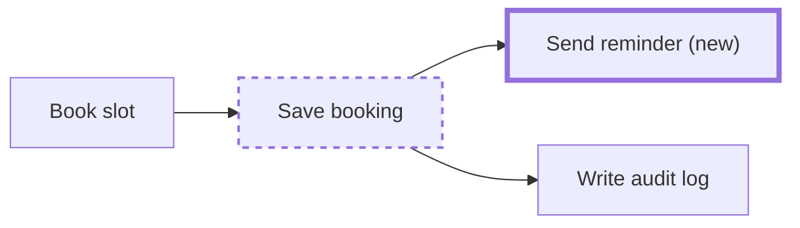

# Diagrams

Draw a diagram when it shows faster than text: how parts connect, the order of steps, the states an object moves through. The text still says the same thing; the diagram is how a reader sees it at once.

## Where a diagram is required
- A TP's Architecture: a flowchart of the parts and what each sends to the next.
- Each flow of a UX document: a flowchart, one per flow, whose steps cite FR and EX ids.
- An FRD's States, unless it says "n/a: <reason>": a stateDiagram-v2, with the transitions that must not happen as ST rows.
- PRODUCT and PRD: optional, when it explains faster than text.

## Which diagram answers which question
| Question | Type |
|---|---|
| What are the parts and how do they connect? | flowchart |
| In what order do two or more parts talk? | sequenceDiagram |
| What states does an object move through? | stateDiagram-v2 |
| What data is kept and how is it related? | erDiagram |
| What types and members does the code share? | classDiagram |

Use only these five. GitHub renders them with nothing installed; newer or beta types may not render on GitHub, and the docs lint fails them.

## Keep it small
- One question per diagram. Split an overview from its detail instead of growing one diagram.
- 15 nodes or fewer. The lint warns above 15.
- Short labels, one line each. Label every arrow whose meaning is not obvious.

## Keep it renderable
- Quote a label that holds ( ) [ ] { } : or other punctuation: A["Book (slot)"].
- No HTML in a label, not even  .
- Never name a node end in lowercase; write End.
- No fills, colors or themes: GitHub's light and dark modes choose them. The one allowed styling is the stroke-only classes of "Draw before you build".
- Never install a renderer or download a browser to check a diagram; push it and look at it on GitHub.

## Cite the rows
A step that is a system response cites its FR id, a branch the examples cover cites its EX id, a transition cites its ST id. A diagram with no ids cannot be traced by any check.

## Draw before you build
Work on code that exists starts with two pictures, so a gap shows before any code is written. Skip both for a greenfield project: there is nothing to draw today.

1. **Draw today.** One diagram of the part you will change, as the code is now. Existing nodes are what the spec's Reuses section names.
2. **Draw proposed.** The same diagram after the change. Mark each node with a class: existing keeps the thin default, changed is dashed, new is thick. Strokes only, no fills or colors.
3. **Read the gaps.** A new or changed node with no Files row in the spec is a gap. So is an arrow no document explains. Each gap becomes an Open question, a Files row or a Reuses entry; never leave one unnamed.
4. **Do not rewrite what exists.** A node marked existing is reused as it stands. If the change must alter it, mark it changed and give it a Files row.

A diagram that cannot take classes (erDiagram, sequenceDiagram) says "(new)" or "(changed)" in the label instead.

| Document | What to draw before building |
|---|---|
| PRD | Optional: the use cases and who starts them. |
| FRD | States as they are now and as proposed, when it has states. |
| UX | Each flow now and proposed, steps citing FR and EX ids. |
| TP | Architecture now and proposed, with the strokes above. |
| Spec | The proposed diagram cut to its files; each changed or new node matches a Files row. |
| Fix | Today's path of the bug and the one node the fix changes. |
| Adopt | The system as the code does it, before any document is moved. |

Worked example, a booking that gains a reminder:

Reading it: "Save booking" changes to call the reminder, so it needs a Files row; "Send reminder" is new, so it needs one too; "Write audit log" is reused as it stands.
