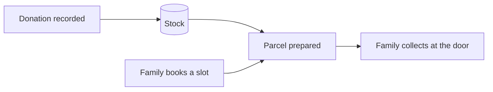

# Larder: product overview

Status: Approved (2026-11-21)
Approval: content WElsOtXp1oyQ

## Summary

Larder helps a community food bank record what it receives and lets families book a weekly pickup slot, so food reaches the families who need it without queues. It serves families, volunteers and the pantry coordinator. The rules that matter most: one booking per family per week, a slot never holds more families than it has places, and every stock number comes from a recorded donation or handout. Larder is a made-up product used as the worked example of Scriptorium; its figures are illustrative.

Last change: 2026-11-12, approved with the pickups slice mapped and donations planned

Decisions not yet absorbed: [DECISIONS.md](DECISIONS.md). Terms: [GLOSSARY.md](GLOSSARY.md).

## 1. Problem

At the pilot pantry (spring 2026, illustrative figures), families queued from 07:00 for doors that open at 10:00. The volunteer log shows 31 of 120 weekly parcels (26%) went unclaimed while other families left empty-handed, because nobody knew in advance who was coming. Donations were counted on paper, so the shelf count differed from the real stock by about 15% on a typical Friday.

## 2. Product
The pantry shall publish its slots each week.

Larder has two halves: what comes in (donations and stock) and what goes out (pickup slots booked by families).

## 3. Users

- **Family:** a household that collects a parcel. Often on a phone with a small screen, in English or Spanish.
- **Volunteer:** records donations and hands out parcels at the door. Works on a shared tablet.
- **Coordinator:** sets the opening hours and the places per slot, reads the weekly numbers.

## 4. Principles

1. **A family's data stays the family's.** A family reads and changes only its own records; volunteers see only what the door needs.
2. **No family is turned away by a screen.** Every screen works on a cheap phone and in English and Spanish.
3. **The same rule for every family.** Limits such as the weekly booking apply equally; no screen has a special case.
4. **Stock is never guessed.** A number on a screen comes from a recorded donation or handout, never from an estimate.

## 5. Use cases

| ID | Name | Description |
| --- | --- | --- |
| UC-1 | Record a donation | A volunteer enters what arrived, and the stock rises by that amount. |
| UC-2 | See what is in stock | A volunteer or the coordinator reads the current stock by item. |
| UC-3 | Book a pickup slot | A family picks a free slot for the week and gets a confirmation. |
| UC-4 | Cancel a booking | A family gives its slot back in time for another family to take it. |

## 6. Scope

In this version: booking and cancelling pickup slots, in English and Spanish. Planned next: recording donations and reading stock. Out: deliveries, payments, and anything about the family's finances.

## 7. Slice map

| Slice | Folder | Covers | Use cases |
|---|---|---|---|
| pickups | `docs/pickups/` | Booking and cancelling pickup slots | UC-3, UC-4 |
| donations | `docs/donations/` (planned) | Recording donations and reading stock | UC-1, UC-2 |

## 8. Success criteria

Within two months of release, unclaimed parcels fall from 26% to under 10% of the weekly total, and the median time a family spends at the door is under 5 minutes.

## 9. Constraints and facts

| Fact | Effect | Verified |
|---|---|---|
| Volunteers use their own phones and one shared tablet | Screens work at 360 px width | Volunteer survey, 2026-11-05 (illustrative) |
| The pantry opens Tuesday to Saturday, 09:00 to 17:00 | Slots exist only inside those hours | Coordinator, 2026-11-05 |
| About 40% of families read Spanish first | Every message exists in both languages | Pantry sign-in sheet, 2026-10 (illustrative) |

## 10. Open questions

None.
